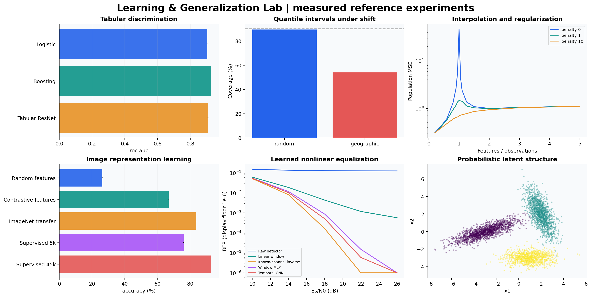

# Learning & Generalization Lab

**Build models you can explain, evaluate predictions you can trust, and understand when they fail.**

An equation-to-experiment laboratory for probabilistic machine learning and deep learning.
It connects Gaussian inference, kernels, mixture models, modern tabular networks,
contrastive image representations, and learned signal equalization through one question:
**what evidence supports using this model on new data?**

Developed by **Navid Bagheri-Shouraki**, from earlier machine learning and deep learning
coursework into a reproducible research and applied data science portfolio. The theoretical
foundation follows [Murphy's Probabilistic Machine Learning](https://probml.github.io/book1)
and [Goodfellow, Bengio, and Courville's Deep Learning](https://www.deeplearningbook.org/).
The extensions focus on calibration, conformal inference, distribution shift,
representation learning, statistical comparisons, practical decision costs, and
image inverse problems with explicit observation models.



## What is inside

| Study | Substantial question | Implementations and evidence |
|---|---|---|
| [Probabilistic foundations](docs/01_probabilistic_models.md) | What does a posterior represent, and when does clustering recover geometry? | Gaussian posterior from scratch; log-domain full-covariance EM; held-out density, BIC, clustering stability |
| [Tabular decisions](docs/02_tabular_decisions.md) | Does a neural network improve a well-tuned classical model? | Adult official splits; logistic regression, histogram boosting, residual tabular network; calibration, utility, subgroup and permutation diagnostics |
| [Regression and uncertainty](docs/03_uncertainty_and_shift.md) | Does a nominal 90% interval remain reliable under geographic shift? | California Housing; ridge, Bayesian ridge, boosting and numerical feature transformer; posterior intervals, split conformal and CQR |
| [Generalization](docs/04_generalization.md) | Why can interpolation coexist with good prediction, and what does GD prefer? | Repeated double-descent study with exact population risk; ridge controls; logistic implicit-bias experiment and hard-margin reference |
| [Kernels](docs/04_generalization.md#kernel-learning-curves) | When do nonlinear features pay off with limited data? | Exact RBF SVM, Nyström approximation, logistic regression; validation-selected regularization; repeated label budgets |
| [Image representations](docs/05_representation_learning.md) | What changes when labels, unlabeled images, or external pretraining are available? | Full CIFAR-10; residual CNN, contrastive pretraining, frozen random features and ImageNet transfer; identical low-label splits, calibrated prediction sets and corruption diagnostics |
| [Signal equalization](docs/06_signal_equalization.md) | Can a learned receiver remove nonlinear distortion and channel memory? | Gray-coded 16-QAM simulator; linear window equalizer, MLP, temporal CNN, known-channel inversion; BER across SNR and channel shift |
| [Course mixture geometry](docs/10_course_projects.md) | Can a density model recover overlapping labels or impute missing observations? | Supplied coordinates; custom/library/variational GMMs; categorical EM with missing data |
| [Bayesian reconstruction](docs/10_course_projects.md#phase-2-the-correct-posterior) | Does the actual corruption match the stated likelihood? | Stable mixture conditioning, MMSE versus hard estimates, six patch sizes, archive audit, validation-only forward calibration |
| [Denoising](docs/11_image_restoration.md) | When does residual learning beat PCA and an autoencoder? | 10,000 MNIST test images; three seeds; noise-conditioned CNN; PCA shrinkage; noise shift |
| [Super-resolution](docs/11_image_restoration.md) | What survives a 4× information bottleneck? | CC BY natural images; bicubic/autoencoder/residual pixel shuffle; two seeds; blur mismatch; paired comparisons |
| [Colorization](docs/11_image_restoration.md) | How do exact-color fidelity and plausible chroma differ? | Lab autoencoder, ImageNet transfer and balanced palette classification; DeltaE, chroma and entropy |
| [Modern pretrained reference](docs/11_image_restoration.md#frozen-ddcolor-reference) | What changes with a large externally trained color decoder? | Pinned official DDColor-ModelScope; lightness-only inputs, identical test images, checked weights, throughput and explicit exposure limits |

All tables and figures are built from saved experiment records. Compact integration runs
are separate from reference studies. See the [measured report](docs/results.md) for
completed budgets, variability, comparisons and limitations.

The [course-project extension report](docs/project_results.md) adds reconstruction
galleries, complete training curves, paired-image evidence, and an audit of the newly
provided briefs and corrupted images.

<!-- RESULTS_START -->
**Completed reference results:** Adult boosting AUROC **0.9257** (three seeds); CIFAR-10 full supervised accuracy **92.79%** (one run); temporal receiver BER **0.000510** at 18 dB (three seeds). The housing study documents pronounced coverage loss under geographic shift. Read the [full report](docs/results.md) for protocols and limitations.
<!-- RESULTS_END -->

**Added project results:** residual denoising **29.85 dB** versus PCA **23.40 dB**;
4× residual SR **23.87 dB** versus bicubic **22.14 dB**; supplied m=4 image
reconstruction **18.86 dB** after validation-only calibration, versus **9.39 dB**
for the corrupted input. The [extension report](docs/project_results.md) includes
seed variation, fixed galleries, failure analysis and the frozen DDColor comparison.

## Run it

Python 3.10+; Linux/macOS CPU works for probabilistic, kernel and generalization studies.
CUDA is useful for neural studies. Install the appropriate PyTorch build for your machine
using the [official installation instructions](https://pytorch.org/get-started/locally/).

```bash
python -m venv .venv
source .venv/bin/activate
python -m pip install -e '.[deep,notebooks,dev]'
python -m pytest -q
python -m learning_lab.cli probabilistic --quick
```

The reference configs use the author's shared dataset cache. For another machine,
prepare a local cache and pass its path explicitly:

```bash
python scripts/prepare_data.py --data-root .local/data
python -m learning_lab.cli classification --data-root .local/data --device cpu --quick
python -m learning_lab.cli regression --data-root .local/data --device cpu
python -m learning_lab.cli generalization
python -m learning_lab.cli kernels
```

Image training requires the official CIFAR-10 Python archive and ResNet18 ImageNet weights.
See [reproduction](docs/07_reproduction.md) for explicit preparation, full runs, GPU selection,
CPU overrides, artifact regeneration, and environment details. Training never silently downloads
data or model weights.

## Follow an idea into code

Start with the [learning path](docs/00_start_here.md), or open the thirteen executed
[notebooks](notebooks/README.md). Each chapter includes assumptions, equations,
implementation links, an experiment to inspect, and an exercise with a worked answer.

```text
src/learning_lab/       reusable numerical methods, networks, experiments and CLI
configs/               complete reference budgets and explicit data/model paths
notebooks/             executed English walkthroughs
docs/                  derivations, protocols, model cards, results and references
assets/                generated plots (PNG and PDF)
results/reference/     metrics, histories, exact splits and environment records
tests/                 mathematical, statistical and interface checks
scripts/               explicit preparation, reporting, inference and release checks
legacy/                source inventory; original files remain local and excluded from Git
```

The project demonstrates experimental design, statistical reasoning, model implementation,
applied error analysis, and reproducible engineering. Classical methods remain meaningful
baselines; neural and pretrained models receive explicit data and compute budgets.
Reported findings describe these experiments rather than claiming new algorithms or
state-of-the-art performance. [Model cards](docs/09_model_cards.md) explain intended use
and practical limits.

## Attribution

The public code and English explanations are a new implementation. Original assignment
files and third-party paper PDFs are preserved locally; they are excluded from the release.
The [source audit](docs/08_source_audit.md) maps the original topics to the completed studies.
Methods and datasets are credited in [references](docs/references.md).

MIT license for repository code and original documentation. Dataset and pretrained-model
terms remain with their respective sources. To cite the laboratory, use [CITATION.cff](CITATION.cff).
Natural-image figures and their compact source arrays retain [CC BY photo attribution](docs/photo_attributions.md).
