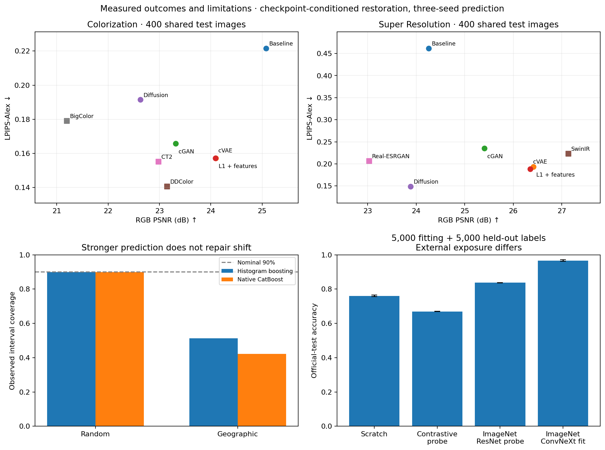

# Machine Learning and Deep Learning

[Interactive demo](https://navidbagheri7.github.io/Machine-Learning-and-Deep-Learning/) · [GitHub repository](https://github.com/navidbagheri7/Machine-Learning-and-Deep-Learning) · [CI checks](https://github.com/navidbagheri7/Machine-Learning-and-Deep-Learning/actions)

A reproducible laboratory for probabilistic inference, modern prediction systems,
conditional image generation and distribution shift. Implementations connect equations
to trained models, held-out comparisons and usable saved-model inference.

Developed by **Navid Bagheri-Shouraki**, from earlier machine learning and deep learning
coursework into a reproducible research and applied data science portfolio. The theoretical
foundation follows [Murphy's Probabilistic Machine Learning](https://probml.github.io/book1)
and [Goodfellow, Bengio, and Courville's Deep Learning](https://www.deeplearningbook.org/).
The extensions focus on calibration, conformal inference, distribution shift,
representation learning, statistical comparisons, practical decision costs, and
image inverse problems with explicit observation models.

The modern extension compares conditional GANs, conditional VAEs and diffusion with
frozen DDColor, CT2, BigColor, SwinIR and Real-ESRGAN on original 256px photographs.
It also adds native categorical/quantile boosting, three-seed ConvNeXt transfer and
natural-image denoising under noise mismatch. [Measured comparisons](docs/modern_results.md),
[model equations and protocols](docs/12_generative_restoration.md), and the
[implementation audit](docs/13_implementation_audit.md) separate practical gains from
remaining failures. The [upgrade work log](docs/upgrade_worklog.md) records current completion.

Open the [interactive explorer](docs/explorer.html) locally by double-clicking it, or
serve the repository with `python -m http.server 8000` and visit
`http://localhost:8000/docs/explorer.html`. It runs entirely in your browser.
The [demo guide](docs/14_interactive_explorer.md) explains all eight concepts,
controls, evidence and optional GitHub Pages setup.


The completed comparison extension adds **243 classical prediction models** across
five dataset/split cases and three seeds, **63 clustering fits**, and **20 controlled
restoration fits** spanning hinge, logistic/R1, least-squares and WGAN-GP objectives.
[Validation-selected comparisons](docs/adversarial_results.md) and
[20 fixed final-epoch diagnostics](docs/adversarial_endpoints.md) expose unsuccessful
updates as well as useful changes. These are separate deployment and diagnostic policies.



The [modern report](docs/modern_results.md) includes every stochastic draw, paired
image intervals and comparisons against a trained direct predictor. It also explains
why a grayscale baseline's mean PSNR can misrepresent typical color recovery.

The [user interaction audit](docs/demo_review.md) documents exhaustive enabled
dropdown checks, representative joint slider settings and source-bound asset checks.

## What is inside

| Study | Substantial question | Implementations and evidence |
|---|---|---|
| [Classical prediction](docs/classical_results.md) | Which modeling assumptions and ensembles work on each split? | LDA/QDA, logistic/linear models, KNN, SVM/SVR, bagging, forests, boosting, voting and leakage-aware stacking; separate selection/calibration; saved-model prediction sets and intervals |
| [Clustering geometry](docs/clustering_results.md) | When do density, connectivity and Gaussian assumptions recover structure? | KMeans, full/variational GMM, Ward, spectral, DBSCAN and HDBSCAN; Wine, Digits and unequal-density mixtures; noise coverage and external diagnostics |
| [Adversarial objectives](docs/adversarial_results.md) | What do objective and regularization changes actually change? | Matched warm starts, five controlled families, both tasks and seeds; validation includes epoch zero; fixed final endpoints reveal effects hidden by selection |
| [Conditional colorization](docs/12_generative_restoration.md) | Does a generative model improve appearance, exact color, or diversity? | Direct predictor, conditional GAN, CVAE and velocity diffusion; frozen DDColor, CT2 and BigColor; 256px source photographs, prior-only sampling, LPIPS, DeltaE and dispersion |
| [Modern 4× super-resolution](docs/12_generative_restoration.md) | Which details are reconstructed, and which depend on a learned prior? | Matched local direct/GAN/CVAE/diffusion models, frozen SwinIR and Real-ESRGAN; actual LR observations, fidelity/perception comparisons and blur/noise/JPEG stress tests |
| [Native boosting](docs/modern_results.md#native-categorical-boosting) | Do categorical and quantile models improve practical decisions? | CatBoost with isolated selection and calibration; subgroup reliability, permutation diagnostics, deployable prediction sets and intervals; random/geographic housing protocols |
| [Modern image transfer](docs/modern_results.md#limited-label-convnext-transfer) | What does fine-tuning add with 5,000 fitting labels? | Three-seed ImageNet ConvNeXt fine-tuning; 5,000 additional selection/calibration labels; identical CIFAR partitions, paired NLL comparisons, confusion matrices, precision-bound deployment prediction sets and corruption failures |
| [Natural-image noise shift](docs/modern_results.md#natural-image-denoising-and-noise-shift) | Does a strong denoiser remain useful at a different noise level? | Wavelet BayesShrink versus frozen SwinIR on 400 photographs at three noise levels; retained sigma50 failure |
| [Probabilistic foundations](docs/01_probabilistic_models.md) | What does a posterior represent, and when does clustering recover geometry? | Gaussian posterior from scratch; log-domain full-covariance EM; held-out density, BIC, clustering stability |
| [Tabular decisions](docs/02_tabular_decisions.md) | Does a neural network improve a well-tuned classical model? | Adult official splits; logistic regression, histogram boosting, residual tabular network; calibration, utility, subgroup and permutation diagnostics |
| [Regression and uncertainty](docs/03_uncertainty_and_shift.md) | Does a nominal 90% interval remain reliable under geographic shift? | California Housing; ridge, Bayesian ridge, boosting and numerical feature transformer; posterior intervals, split conformal and CQR |
| [Generalization](docs/04_generalization.md) | Why can interpolation coexist with good prediction, and what does GD prefer? | Repeated double-descent study with exact population risk; ridge controls; logistic implicit-bias experiment and hard-margin reference |
| [Kernels](docs/04_generalization.md#kernel-learning-curves) | When do nonlinear features pay off with limited data? | Exact RBF SVM, Nyström approximation, logistic regression; validation-selected regularization; repeated label budgets |
| [Image representations](docs/05_representation_learning.md) | What changes when labels, unlabeled images, or external pretraining are available? | Full CIFAR-10; residual CNN, contrastive pretraining, frozen random features and ImageNet transfer; identical low-label splits, calibrated prediction sets and corruption diagnostics |
| [Signal equalization](docs/06_signal_equalization.md) | Can a learned receiver remove nonlinear distortion and channel memory? | Gray-coded 16-QAM simulator; linear window equalizer, MLP, temporal CNN, known-channel inversion; BER across SNR and channel shift; saved-checkpoint decoding |
| [Course mixture geometry](docs/10_course_projects.md) | Can a density model recover overlapping labels or impute missing observations? | Supplied coordinates; custom/library/variational GMMs; categorical EM with missing data |
| [Bayesian reconstruction](docs/10_course_projects.md#phase-2-the-correct-posterior) | Does the actual corruption match the stated likelihood? | Stable mixture conditioning, MMSE versus hard estimates, six patch sizes, archive audit, validation-only forward calibration |
| [Denoising](docs/11_image_restoration.md) | When does residual learning beat PCA and an autoencoder? | 10,000 MNIST test images; three seeds; noise-conditioned CNN; PCA shrinkage; noise shift |
| [Super-resolution](docs/11_image_restoration.md) | What survives a 4× information bottleneck? | CC BY natural images; bicubic/autoencoder/residual pixel shuffle; two seeds; blur mismatch; paired comparisons |
| [Colorization](docs/11_image_restoration.md) | How do exact-color fidelity and plausible chroma differ? | Lab autoencoder, ImageNet transfer and balanced palette classification; DeltaE, chroma and entropy |
| [Modern pretrained reference](docs/11_image_restoration.md#frozen-ddcolor-reference) | What changes with a large externally trained color decoder? | Pinned official DDColor-ModelScope; lightness-only inputs, identical test images, checked weights, throughput and explicit exposure limits |

All tables and figures are built from saved experiment records. Compact integration runs
are separate from reference studies. The [foundations report](docs/results.md),
[course-project report](docs/project_results.md), and [modern report](docs/modern_results.md)
document their respective budgets, variability, comparisons and limitations.

The [course-project extension report](docs/project_results.md) adds reconstruction
galleries, complete training curves, paired-image evidence, and an audit of the newly
provided briefs and corrupted images.

<!-- MODERN_RESULTS_START -->
**Completed modern measurements:** ConvNeXt fine-tuning reaches **96.65%** CIFAR-10 accuracy with 5,000 fitting labels, 5,000 selection/calibration labels and ImageNet initialization (three seeds); native CatBoost reaches Adult AUROC **0.9271** (three seeds). SwinIR achieves SR PSNR **27.13 dB**; local diffusion achieves LPIPS **0.1486** with PSNR **23.88 dB**, showing a fidelity/perception tradeoff. Geographic interval failure, noise mismatch, ambiguous colors and weak CVAE diversity remain visible in the [modern report](docs/modern_results.md). The laboratory contains 68 completed reference protocols, 20 additional fixed-endpoint evaluations and 22 English walkthroughs.
<!-- MODERN_RESULTS_END -->

<!-- RESTORATION_PREVIEW_START -->
<details>
<summary>Fixed visual comparisons across all restoration pipelines</summary>

Four attributed held-out photographs, with seed0/draw0 fixed for every pipeline. Full galleries retain all fitted seeds and stochastic draws.


</details>
<!-- RESTORATION_PREVIEW_END -->

<!-- RESULTS_START -->
**Completed reference results:** Adult boosting AUROC **0.9257** (three seeds); CIFAR-10 full supervised accuracy **92.79%** (one run); temporal receiver BER **0.000510** at 18 dB (three seeds). The housing study documents pronounced coverage loss under geographic shift. Read the [full report](docs/results.md) for protocols and limitations.
<!-- RESULTS_END -->

**Added project results:** residual denoising **29.85 dB** versus PCA **23.40 dB**;
4× residual SR **23.87 dB** versus bicubic **22.14 dB**; supplied m=4 image
reconstruction **18.86 dB** after validation-only calibration, versus **9.39 dB**
for the corrupted input. The [extension report](docs/project_results.md) includes
seed variation, fixed galleries, failure analysis and the frozen DDColor comparison.

## Run it

Python 3.10+; Linux/macOS CPU works for probabilistic, kernel and generalization studies.
CUDA is useful for neural studies. Install the appropriate PyTorch build for your machine
using the [official installation instructions](https://pytorch.org/get-started/locally/).

```bash
python -m venv .venv
source .venv/bin/activate
python -m pip install -e '.[deep,notebooks,dev]'
python -m pytest -q
python -m learning_lab.cli probabilistic --quick
```

For native boosting and modern restoration, add the corresponding optional dependencies:

```bash
python -m pip install -e '.[deep,boosting,restoration,pretrained,notebooks,dev]'
python scripts/make_portable_configs.py --help
python scripts/restore_generative.py --help
python scripts/restore_external.py --help
python scripts/predict_modern.py --help
python scripts/predict_classical.py --help
```

Saved-model inference does not require training data. Model checkpoints and downloaded
datasets stay outside the published repository; the public release contains their
provenance, metrics and compact numerical evidence. Explicit preparation and fitting
commands are documented in [reproduction](docs/07_reproduction.md).

The reference configs use the author's shared dataset cache. For another machine,
prepare a local cache and pass its path explicitly:

```bash
python scripts/prepare_data.py --data-root .local/data
python -m learning_lab.cli classification --data-root .local/data --device cpu --quick
python -m learning_lab.cli regression --data-root .local/data --device cpu
python -m learning_lab.cli generalization
python -m learning_lab.cli kernels
python scripts/run_classical.py --dataset breast_cancer --seed 0 --quick
python scripts/run_clustering.py --help
```

Image training requires the official CIFAR-10 Python archive and ResNet18 ImageNet weights.
See [reproduction](docs/07_reproduction.md) for explicit preparation, full runs, GPU selection,
CPU overrides, artifact regeneration, and environment details. Training never silently downloads
data or model weights.

## Follow an idea into code

Start with the [learning path](docs/00_start_here.md), or open the
[notebooks](notebooks/README.md). Each chapter includes assumptions, equations,
implementation links, an experiment to inspect, and an exercise with a worked answer.

```text
src/learning_lab/       reusable numerical methods, networks, experiments and CLI
configs/               complete reference budgets and explicit data/model paths
notebooks/             executed English walkthroughs
docs/                  derivations, protocols, model cards, results and references
assets/                generated plots (PNG and PDF)
results/reference/     metrics, histories, exact splits and environment records
tests/                 mathematical, statistical and interface checks
scripts/               explicit preparation, reporting, inference and release checks
legacy/                source inventory; original files remain local and excluded from Git
```

The project demonstrates experimental design, statistical reasoning, model implementation,
applied error analysis, and reproducible engineering. Classical methods remain meaningful
baselines; neural and pretrained models receive explicit data and compute budgets.
Reported findings describe these experiments rather than claiming new algorithms or
state-of-the-art performance. [Model cards](docs/09_model_cards.md) explain intended use
and practical limits.

## Attribution

The public code and English explanations are a new implementation. Original assignment
files and third-party paper PDFs are preserved locally; they are excluded from the release.
The [source audit](docs/08_source_audit.md) maps the original topics to the completed studies.
Methods and datasets are credited in [references](docs/references.md).

MIT license for repository code and original documentation. Dataset and pretrained-model
terms remain with their respective sources. To cite the laboratory, use [CITATION.cff](CITATION.cff).
Natural-image figures and their compact source arrays retain [CC BY photo attribution](docs/photo_attributions.md).
