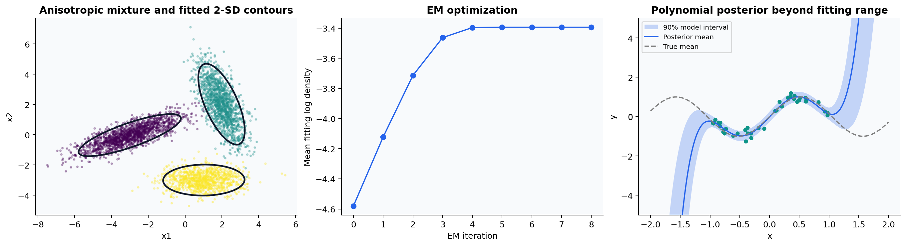

# Probabilistic models: posterior inference and latent structure

This chapter follows the Gaussian and latent-variable foundations of
[Murphy](https://probml.github.io/book1). Implementations are in
[probabilistic.py](../src/learning_lab/probabilistic.py); the measured experiment is in
[studies.py](../src/learning_lab/studies.py).

## Gaussian posterior regression

Let the design matrix contain the chosen basis functions, including an intercept if
one is needed. The model is

$$w\sim\mathcal N(0,\tau^2 I),\qquad y\mid X,w\sim\mathcal N(Xw,\sigma^2 I).$$

Completing the square in the joint log density gives

$$\Lambda=\tau^{-2}I+\sigma^{-2}X^TX,\quad
\Sigma=\Lambda^{-1},\quad m=\Lambda^{-1}\sigma^{-2}X^Ty.$$

For a new basis row $\phi(x)$,

$$y_*\mid x_*,D\sim\mathcal N(\phi(x_*)m,
\sigma^2+\phi(x_*)\Sigma\phi(x_*)^T).$$

The two variance terms represent observation noise and parameter uncertainty under
this model. The implementation uses `solve` for the mean and covariance, avoiding
an explicit inverse in the parameter estimate. Its mean matches ridge regression
with penalty $\lambda=\sigma^2/\tau^2$ and the same intercept convention; the test
suite checks this identity to numerical precision.

The demonstration uses degree-five Legendre features, observations on $[-1,1]$, and
a wider prediction grid. The model is intentionally imperfect: a polynomial cannot
represent every sinusoidal behavior. Larger posterior variance outside the training
region describes uncertainty within the assumed feature family. It is not evidence
that the model accounts for every possible misspecification.

## Gaussian mixture EM

The density and responsibility are

$$p(x)=\sum_{k=1}^K\pi_k\mathcal N(x;\mu_k,\Sigma_k),\qquad
r_{ik}=\frac{\pi_k\mathcal N(x_i;\mu_k,\Sigma_k)}{\sum_j\pi_j\mathcal N(x_i;\mu_j,\Sigma_j)}.$$

With $N_k=\sum_i r_{ik}$, the M-step is

$$\pi_k=N_k/n,\quad \mu_k=N_k^{-1}\sum_i r_{ik}x_i,\quad
\Sigma_k=N_k^{-1}\sum_i r_{ik}(x_i-\mu_k)(x_i-\mu_k)^T.$$

`GaussianMixtureEM` evaluates log densities with Cholesky factorization and normalizes
responsibilities with `logsumexp`. A small diagonal covariance floor prevents singular
updates. Collapsed components cause an explicit error rather than a fabricated metric.
Initialization uses K-means; fitting remains nonconvex, so multiple starts matter.

For model selection the study fits one through six components with the reference
implementation, records BIC on fitting data, and evaluates held-out density. The BIC
parameter count for full covariance includes means, symmetric covariance entries,
and $K-1$ mixture weights. Held-out negative log likelihood checks density prediction;
adjusted Rand index checks agreement with known synthetic labels. These are different
goals, and a lower density loss does not imply a perfect label partition.

The synthetic components are anisotropic. K-means uses isotropic Euclidean geometry;
the mixture model learns component covariance. The chapter also evaluates bootstrap
cluster stability on the bundled Wine data. Class labels are used only for post-fit
ARI, never as fitting features. The Wine scaling is fitted on the entire descriptive
dataset: this is an exploratory stability analysis, not a held-out predictive benchmark.

## Exercises with answers

**Why does multiplying every feature by ten change the meaning of the prior?**
The same function can be represented with coefficients ten times smaller. An unchanged
isotropic coefficient prior therefore induces a different function prior. Feature
scaling is part of the model specification, not a purely cosmetic transformation.

**Why can a mixture's likelihood increase while a covariance collapses?** A component
can put its mean on an observation and shrink its covariance, making that observation's
density arbitrarily large. Covariance constraints or priors address this pathology.
Checking finite likelihood alone does not certify a valid model.

**Does cluster stability establish that three wine clusters are scientifically real?**
No. It establishes repeatability under the chosen resampling and geometry. A stable
partition can reflect scaling choices or a method's inductive bias. Interpret stability,
density fit and external labels separately.

Run `python -m learning_lab.cli probabilistic`; inspect the saved EM history and compare
the posterior's interpolation and extrapolation uncertainty in notebook 01.
