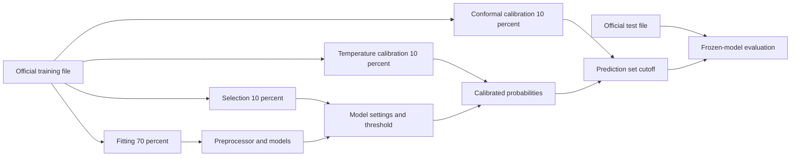
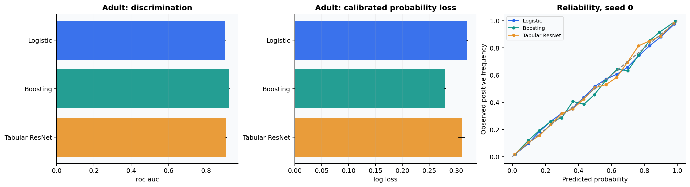

# Tabular prediction as a decision problem

The original salary SVM example becomes a reproducible study of the UCI Adult data.
The binary target is annual income above $50,000 in the historical dataset. This is
a benchmark for evaluating methods, not a current income estimator or employment tool.
See the [dataset source](https://archive.ics.uci.edu/dataset/2/adult) and
[implementation](../src/learning_lab/tabular.py).

## Information boundaries

The official training file is partitioned into 70% fitting, 10% selection, 10%
probability calibration, and 10% conformal calibration. The official test file is
preserved. Partitions are stratified and saved as exact indices for three seeds.

Numeric imputation and scaling, and categorical imputation and one-hot vocabularies,
are learned from fitting data only. Missing values are retained for imputation;
unseen categories are accepted at inference. `education_num` replaces its duplicate
text feature. The census survey weight `fnlwgt` is excluded as a predictor. The study
reports unweighted predictive metrics on these files and does not estimate a
survey-weighted population statistic.

## Models and selection

Logistic regression gives an interpretable linear log-odds baseline. Histogram gradient
boosting captures nonlinear interactions. A residual tabular network uses LayerNorm,
GELU, dropout, AdamW and early stopping. The architectural motivation follows
[Gorishniy et al.](https://arxiv.org/abs/2106.11959), with a compact implementation rather
than a reproduction of their entire benchmark.

Logistic regression selects $C\in\{0.1,1,10\}$; boosting selects leaf budgets in
$\{15,31,63\}$. Selection uses validation log loss. The residual network selects its
epoch with validation BCE and a fixed architecture. This is a modest, declared search
budget; it does not demonstrate globally optimal hyperparameters or identical compute
across model families.

$$\mathcal L_{\mathrm{log}}=-\frac1n\sum_i[y_i\log p_i+(1-y_i)\log(1-p_i)].$$

AUROC evaluates ordering across thresholds, average precision emphasizes the positive
class, log loss and Brier score evaluate probability quality, and ECE is a descriptive
bin-dependent diagnostic. Every calibrated metric also records its raw log loss.

## Calibration and decisions

Temperature scaling divides the binary logit by a positive scalar selected on the
probability-calibration partition. A distinct partition computes conformal scores.
Using the same labels for both operations would break the simple split-conformal
argument; the implementation keeps them separate.

The illustrative decision cost assigns two units to a false negative and one to a
false positive. A threshold is selected on validation data. For calibrated probabilities
and these costs, the ideal Bayes threshold is $1/(1+2)=1/3$, though finite validation
data can select a nearby or different threshold. No application utility is inferred
from accuracy alone, and these weights do not encode a real employment policy.

Permutation importance operates on raw features through the fitted pipeline. It
measures how held-out log loss changes after scrambling a feature. Correlated features,
feature redundancy and joint distribution changes complicate causal interpretation.

Subgroup metrics by sex and race include counts, positive-class discrimination,
probability loss, conformal coverage, TPR and FPR at the fixed chosen threshold. Small
groups are omitted below 100 rows. These descriptive diagnostics identify disparities
worth investigating; they do not establish causality or certify a fairness criterion.
Marginal conformal coverage is not a guarantee for every group.

## Statistical comparison

The paired bootstrap resamples the same test examples for both models and estimates
the difference in per-example log loss for seed zero. Pairing preserves dependence
between their errors. These intervals are conditional on fitted models and the test
sample; seed standard deviations describe training-partition variability separately.
Neither addresses an unknown future population shift.

## Worked questions

**Why choose log loss rather than test accuracy for selection?** The downstream workflow
uses probabilities, temperatures, costs and prediction sets. Validation log loss
rewards appropriate probabilities, including their behavior on confident mistakes.
Using test accuracy to choose settings would contaminate the reported test evidence.

**Would adding SMOTE always improve the imbalanced classification problem?** No.
It changes the effective class prior and, with mixed categorical data, can create
implausible interpolated records. If used, it belongs within fitting folds and needs
probability recalibration and a measured utility justification. The reference study
uses the natural class distribution.

**What is delivered for inference?** Fitted logistic and boosting pipelines for seed
zero are saved locally with feature schema, calibration temperature and operating
threshold. The [prediction command](../scripts/predict.py) validates the schema and
produces calibrated probabilities. Checkpoints are excluded from Git; rerunning the
study regenerates them.
