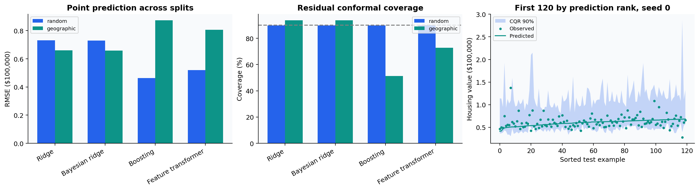

# Uncertainty, conformal prediction, and geographic shift

An uncertainty method needs a population and a guarantee. This chapter compares
Gaussian posterior intervals, residual split-conformal intervals and conformalized
quantile regression on California Housing, then deliberately changes the test geography.
See [uncertainty.py](../src/learning_lab/uncertainty.py) and
[tabular.py](../src/learning_lab/tabular.py).

## Split conformal regression

Fit $\hat f$ without the calibration labels. Compute $s_i=|y_i-\hat f(x_i)|$ on
$n_c$ calibration examples. For requested error rate $\alpha$, set

$$k=\lceil(n_c+1)(1-\alpha)\rceil,\qquad q=s_{(k)},\qquad
C(x)=[\hat f(x)-q,\hat f(x)+q].$$

If $k>n_c$, the valid finite-sample cutoff is infinity. The implementation returns
infinity for this case rather than truncating the rank. Reference runs have sufficiently
large calibration sets for finite intervals. The tests verify the exact order statistic
and empirical repeated-simulation coverage.

Under exchangeability of calibration and test examples, this construction gives a
marginal coverage guarantee. It does not promise conditional coverage for each feature
value, subgroup or future geographic region. The score function must already be fixed
without using calibration labels for model selection.

## Adaptive intervals using quantile regression

Fit lower and upper conditional quantile models $\hat l(x),\hat u(x)$ using fitting
data. Calibrate with

$$s_i=\max\{\hat l(x_i)-y_i,\;y_i-\hat u(x_i)\},\qquad
C(x)=[\hat l(x)-q,\hat u(x)+q].$$

The two quantiles are 0.05 and 0.95. Negative corrections can shrink overly wide
intervals; scores are not arbitrarily clipped to zero. Quantile crossing is repaired
consistently before computing scores. Empty intervals are retained as empty and their
rate is reported, rather than silently widened. This implements the central idea of
[conformalized quantile regression](https://arxiv.org/abs/1905.03222).

## Prediction sets for classification

With class probability $p_y(x)$, use score $1-p_y(x)$ and include class $j$ when
$1-p_j(x)\le q$. Coverage and mean set size must be interpreted together: a method
can achieve high coverage by returning many labels. Empty sets are possible for this
simple score. The code does not force an argmax label into every set, since that
would change the method being evaluated.

## The geographic experiment

Housing values are measured in units of $100,000 and the dataset has a target cap.
Each protocol evaluates ridge, empirical-Bayes ridge, histogram boosting and a numerical
feature transformer. Scaling is learned from fitting rows. Neural targets are centered
and scaled using fitting labels only, and predictions are converted back to target units.
Boosting supplies the CQR lower and upper models; point-model selection is based on
validation MSE and the quantile models reuse those structural hyperparameters.

The random protocol holds out 20% randomly. The geographic protocol holds out the
easternmost approximately 20%, selected by longitude without target labels. Remaining
rows are partitioned into 70% fitting, 10% selection and 20% calibration. These are
separate fitted experiments, not a shared training set with two test views.

In the geographic protocol calibration remains in the western training region. Test
exchangeability is deliberately violated. The resulting coverage is an empirical
stress test; the report never claims distribution-free coverage under this shift.
It also does not interpret geography as time, nor claim a random split is always an
invalid design. The appropriate split follows the actual deployment question.

Gaussian posterior intervals from `BayesianRidge` use its fitted noise and prior
precision. These model-based intervals can be sharp but fail under model mismatch.
Conformal intervals calibrate residual behavior more directly, provided the population
assumptions hold. Compare coverage, width, point MAE/RMSE and capped-target error jointly.

## Worked questions

**Why is `np.quantile(scores, .9)` insufficient?** Its interpolation and rank convention
can differ from $\lceil(n_c+1)(1-\alpha)\rceil$. With nine examples and $\alpha=.2$,
the cutoff is the eighth order statistic. The implementation explicitly selects it.

**Can we fix geographic coverage by choosing a wider interval after looking at test
labels?** We can describe an exploratory adjustment, but it would no longer be the
original held-out evaluation. A defensible next experiment would specify an adaptation
or weighted-conformal procedure using a separate adaptation set, then evaluate new data.

**Does marginal coverage imply a 90% chance that this particular observed house is
inside its interval?** No. The frequentist guarantee averages over calibration and new
examples under exchangeability. A per-example posterior statement uses additional model
assumptions. See [Angelopoulos and Bates](https://arxiv.org/abs/2107.07511) for the distinction.
