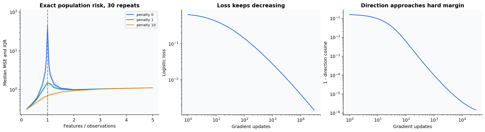
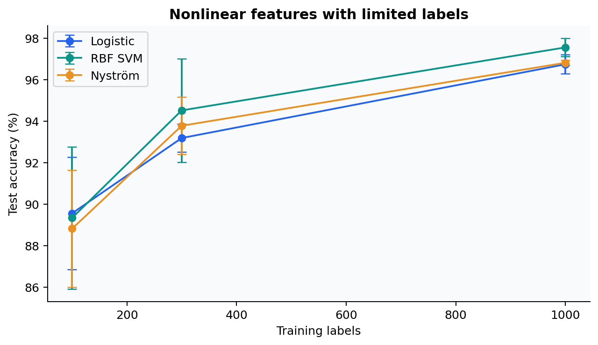

# Generalization: interpolation, regularization, and implicit bias

The source collection included double-descent and implicit-bias readings. This study
turns those themes into controlled numerical experiments with explicit distributions,
exact risk calculations, and regularized controls. See [studies.py](../src/learning_lab/studies.py).

## A controlled double-descent experiment

Use isotropic Gaussian covariates $x\sim\mathcal N(0,I_p)$, a signal supported on the
first ten coordinates, and Gaussian observation noise:

$$y=x^T\beta+\epsilon,\quad \|\beta\|_2=1,\quad \epsilon\sim\mathcal N(0,0.25).$$

There are 100 fitting observations. Feature counts range from 20 to 500, concentrating
points around the interpolation threshold $p=n$. Every width within a repeat uses a
nested feature matrix and the same target. All widths include the true ten-dimensional
signal, so the main experiment does not conflate the interpolation threshold with
changing approximation error. Thirty independent repeats reveal noise variability.

For $X=USV^T$, the minimum-norm solution is $\hat w=VS^{-1}U^Ty$. Ridge changes each
inverse singular value to $s_j/(s_j^2+\lambda)$:

$$\hat w_\lambda=V\operatorname{diag}\!\left(\frac{s_j}{s_j^2+\lambda}\right)U^Ty.$$

The implementation uses penalties 0, 1 and 10 under the convention
$\|Xw-y\|^2+\lambda\|w\|^2$. Dividing the data-fit term by $n$ would change the
numerical meaning of $\lambda$.

For an independent Gaussian test covariate, population MSE is available exactly:

$$\mathbb E[(y_* - x_*^T\hat w)^2\mid\hat w]
=\|\hat w-\beta\|_2^2+0.25.$$

Unused coordinates of a fitted coefficient vector are padded with zeros. The report
therefore measures exact population risk rather than a noisy finite test estimate.
It separately records training error and the smallest singular value. Near-zero
singular values amplify label noise; interpolation is not by itself a guarantee of
good prediction. Ridge changes the amplification and can smooth the interpolation peak.

The curves summarize the actual repeats with a median and interquartile band. Near
interpolation the distribution can be heavy-tailed: a simple mean and standard-error
bar can hide most runs behind an extreme realization. Both the complete raw records
and robust summaries remain available. This is a finite synthetic demonstration, not
an empirical claim about all deep networks.

## Logistic gradient descent and margin direction

On separable data, unregularized logistic loss has no finite minimizer. Scaling a
separating vector keeps decreasing loss. Gradient descent can therefore increase
the coefficient norm while its direction approaches a max-margin separator.

The update in this experiment is

$$w_{t+1}=w_t+\eta\frac1n\sum_i y_i x_i\,
\operatorname{sigmoid}(-y_i x_i^T w_t).$$

The hard-margin reference solves $\min_w\frac12\|w\|^2$ subject to
$y_i x_i^Tw\ge1$ using a constrained quadratic optimization. Both models omit an
intercept, so their parameterization matches. We track loss, norm, direction cosine
and normalized minimum margin, rather than claiming the parameters themselves converge.
The finite 30,000-step run illustrates the behavior studied by
[Soudry et al.](https://arxiv.org/abs/1710.10345); it is not a proof of the asymptotic theorem.

## Kernel learning curves

The bundled handwritten Digits data supports an offline, reproducible learning-curve
study. A fixed stratified test split is shared by all three repetitions. Training
budgets of 100, 300 and 1,000 labels are sampled from a fitting partition; a separate
validation partition selects regularization.

The comparison includes standardized logistic regression, an exact RBF SVM, and a
Nyström RBF feature approximation followed by logistic regression. The kernel map is
fitted using fitting examples only. Its feature budget is `min(200, training_size)`;
the experiment fixes kernel bandwidth and selects $C$. This identifies the declared
budget rather than claiming a full bandwidth search.

Exact kernel methods can be effective with limited data but have unfavorable scaling
as the number of training examples grows. Approximate features trade representation
fidelity for a bounded dimension. The larger CIFAR experiment in the next chapter
evaluates learned representations on a different task; its scores should not be
directly compared with this small digit study.

## Worked questions

**Why does risk rise near interpolation?** Small singular values make $1/s_j$ large,
so noise in the corresponding observation-space directions creates large fitted
coefficients. The exact Gaussian population-risk identity converts that coefficient
error directly into prediction error.

**Why is training MSE alone insufficient?** Many overparameterized solutions interpolate
the same observations but behave differently elsewhere. Minimum norm, ridge and the
optimizer's dynamics specify which solution is selected.

**What does the norm-diverging logistic experiment say about early stopping?** Loss can
continue improving after training labels are perfectly separated. Early stopping
controls finite optimization dynamics; it need not select the same function as explicit
weight decay. Test evidence would be required to choose between them in a predictive task.
