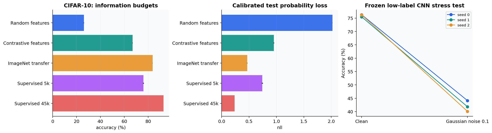

# Image representations with explicit information budgets

The original CIFAR CNN exercise becomes a study of supervised learning, unlabeled
pretraining and external transfer. The question is which information budget buys useful
representations, not whether one method wins an unrestricted architecture race.
Implementation: [vision.py](../src/learning_lab/vision.py).

## Dataset partitions

The official CIFAR-10 training split contains 50,000 examples. The reference run uses
45,000 fitting images, 2,000 selection images, 1,500 probability-calibration images,
and 1,500 conformal-calibration images. The 10,000 official test images are held out.
The same fitting pool is used for contrastive pretraining, and three stratified subsets
of 5,000 fitting labels are used for low-label comparisons. No test image or test label
enters pretraining, selection or calibration.

The 5,000-label count describes fitting labels. Every condition additionally uses the
same 2,000 selection labels and 3,000 calibration labels; these additional labeling costs
are part of the evaluation protocol.

The compact encoder has a CIFAR-scale 3x3 stem, three residual stages with widths
32, 64 and 128, two blocks per stage, and global average pooling. This makes its
inductive bias visible and gives a practical scratch baseline without a massive model.

## Four low-label conditions and a full-data reference

| Condition | Encoder information | Labeled head training |
|---|---|---|
| Frozen random encoder | No learned image representation | 5,000 CIFAR fitting labels |
| Contrastive encoder | 45,000 unlabeled CIFAR fitting images | 5,000 CIFAR fitting labels |
| Frozen ImageNet ResNet18 | External ImageNet labels and images | 5,000 CIFAR fitting labels |
| Supervised residual CNN | 5,000 labeled CIFAR fitting images | Joint encoder/head fitting |
| Full supervised residual CNN | 45,000 labeled CIFAR fitting images | Joint encoder/head fitting |

The random and contrastive encoders share the same architecture. The external ResNet18
has a larger architecture and a different training corpus; it is an informative transfer
reference with additional information, not a controlled causal comparison with the
scratch encoder. Unknown image overlap between external pretraining and CIFAR is not
ruled out by these files.

## Contrastive objective

Two independently augmented views of each fitting image produce projected embeddings.
For normalized embedding $z_i$ and its positive partner $z_{i^+}$,

$$\ell_i=-\log\frac{\exp(z_i^Tz_{i^+}/\tau)}
{\sum_{j\ne i}\exp(z_i^Tz_j/\tau)}.$$

The denominator includes the positive and all other examples except the anchor itself.
The batch uses 256 original images, hence 512 embeddings. Temperature is 0.2. The
projection MLP maps the 128-dimensional encoder output to 64 dimensions; linear probes
use the encoder output before projection. The tests verify that correct positive pairs
have lower loss than permuted pairs.

The implementation follows the principle of [SimCLR](https://arxiv.org/abs/2002.05709),
with batched crop/resize, horizontal flips, brightness/contrast/saturation jitter and
random grayscale. It uses a compact CIFAR architecture, AdamW and a 40-epoch budget,
and omits Gaussian blur and LARS. It is explicitly a compact contrastive study rather
than the paper's exact ImageNet recipe.

## Training and evaluation

Scratch supervised models train with SGD, momentum, weight decay, cosine learning-rate
decay and label smoothing. Low-label runs have 50 epochs each; the full-label reference
has 80. The best supervised checkpoint is selected by unsmoothed validation NLL.
Contrastive pretraining uses its final fixed-budget checkpoint. This avoids using
test performance to choose a pretraining epoch.

Frozen linear heads select $C\in\{0.01,0.1,1\}$ using validation log loss. They do
not update encoder parameters or batch-normalization statistics. Pretrained transfer
uses the official ResNet18 resize, center crop and normalization recipe. The weight
file's SHA-256 is recorded.

Temperature scaling and class prediction sets use separate calibration partitions.
The report shows accuracy, NLL, per-class accuracy, set coverage and set size. Low-label
scratch models are additionally evaluated with fixed Gaussian pixel noise (standard
deviation 0.1 on the [0,1] scale), without adapting their model or temperature. This is
one corruption diagnostic, not the CIFAR-10-C benchmark.

The error gallery shows the **first 32 mistakes in official test order**, with true
and predicted labels and confidence. This deterministic rule avoids selecting only
easy or dramatic examples. A high-confidence error is useful evidence that calibration
is an aggregate property rather than a correctness guarantee for each prediction.

## Worked questions

**Why discard the projection head for a linear probe?** The projection head is optimized
for the contrastive objective and may suppress information useful to downstream tasks.
The experiment explicitly tests the representation before that task-specific projection.

**Does the transfer model's score show that unlabeled CIFAR pretraining is useless?**
No. Its representation has more capacity and external labeled training. A controlled
follow-up would match architectures and data exposures, then compare multiple training
budgets and initialization seeds.

**Do three label subsets establish pretraining variability?** No. Contrastive pretraining
and external weights are fixed across those subsets. Their standard deviation measures
downstream label-subset variability. The full supervised model also has one training
seed, so no three-seed variability claim is made for that row.
