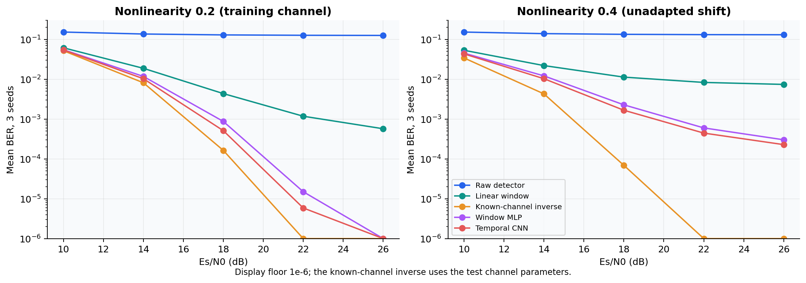

# Learned nonlinear signal equalization

The original deep learning project studied neural receivers and nonlinear channels.
This reconstruction provides a controlled discrete baseband benchmark with testable
numerics, strong classical controls, repeated learned receivers, and explicit shift.
Implementation: [signals.py](../src/learning_lab/signals.py).

## Simulator and conventions

Square 16-QAM uses real and imaginary levels $\{-3,-1,1,3\}/\sqrt{10}$. The average
symbol energy is one. Adjacent axis levels use Gray labels 00, 01, 11, 10, giving one
bit difference between nearest neighboring symbols along an axis. Every symbol carries
four bits.

Independent blocks contain 64 symbols. Within a block the normalized FIR is

$$u_t=\sum_{j=0}^2 h_j s_{t-j},\qquad
h\propto(1,\;0.35+0.15i,\;0.15-0.1i),\quad\|h\|_2=1.$$

The indexing is **circular within a block**. A memoryless amplitude nonlinearity and
complex white noise produce

$$r_t=u_t(1+\gamma|u_t|^2)+n_t,\qquad
n_t\sim\mathcal{CN}(0,N_0),\quad N_0=10^{-\mathrm{SNR}_{\mathrm{dB}}/10}.$$

SNR is $E_s/N_0$ relative to the unit-energy FIR input, not the measured power after
nonlinearity and not $E_b/N_0$. Keeping that convention fixed matters when comparing
nonlinearities. Complex noise gives each real component variance $N_0/2$.

This is an intentionally interpretable synthetic channel. It does not reproduce a
continuous optical-fiber link, dispersion units or a nonlinear Schrödinger solver.
The original report's propagation themes are retained in the source audit rather than
used to imply a physical-fidelity claim unsupported by this benchmark.

## Baselines with declared knowledge

The nearest-constellation detector ignores the channel. A ridge window equalizer uses
seven received-symbol positions to predict real and imaginary transmitted components.
A window MLP uses the same local information and predicts 16 symbol classes. A temporal
CNN learns a wider effective receptive field through circular convolutions.

A separate known-channel inverse has access to the test FIR and test nonlinearity.
It solves $a+\gamma a^3=|r|$ with Newton iterations and divides by the FIR response
in Fourier space. It is a strong knowledge-assisted control, not a data-only learned
competitor. In the zero-noise setting it reconstructs the transmitted symbols to
numerical precision. Noise makes nonlinear inversion and zero forcing imperfect.

## Data and evaluation

For each of three seeds, learned receivers fit 4,000 independent blocks at SNR 18 dB
and $\gamma=0.2$. A separate 500-block validation sample selects the checkpoint.
Evaluation uses 2,000 independent blocks per condition at SNR 10, 14, 18, 22 and 26 dB.
It tests both $\gamma=0.2$ and unadapted $\gamma=0.4$ shift. Overlapping context windows
are formed only after independent block generation, so the fitting and test samples
cannot share neighboring symbols.

$$\mathrm{SER}=\frac{\#\text{incorrect symbols}}{\#\text{symbols}},\qquad
\mathrm{BER}=\frac{\#\text{incorrect bits}}{4\times\#\text{symbols}}.$$

BER uncertainty bootstraps whole blocks, preserving within-block error dependence.
The paired channel samples across methods support meaningful comparisons, although the
displayed per-method intervals are not themselves confidence intervals for a paired
difference. Repeated seeds capture training variation separately. Each condition has
512,000 transmitted bits per seed; zero observed error would not prove zero population
error, and the report states the actual evaluation count.

## Worked questions

**Why can a CNN beat a symbol-wise classifier?** FIR memory makes neighboring received
symbols informative about the transmitted symbol. The baseline MLP receives a local
window too, so the experiment does not attribute every improvement merely to adding
context. Receptive field, parameterization and optimization still differ.

**Why evaluate $\gamma=0.4$ without retraining?** It isolates failure under a fixed
receiver's channel mismatch. Retraining on that channel would answer an adaptation
question. The known-channel inverse knows the new gamma, so its comparison must retain
the explicit knowledge advantage.

**Why is circular indexing acceptable here?** It defines a repeatable block channel
with an exact spectral inverse. For a physical stream, one would introduce guard regions
or a cyclic prefix and account for boundaries and rate overhead. Those effects are
outside the measured experiment.
