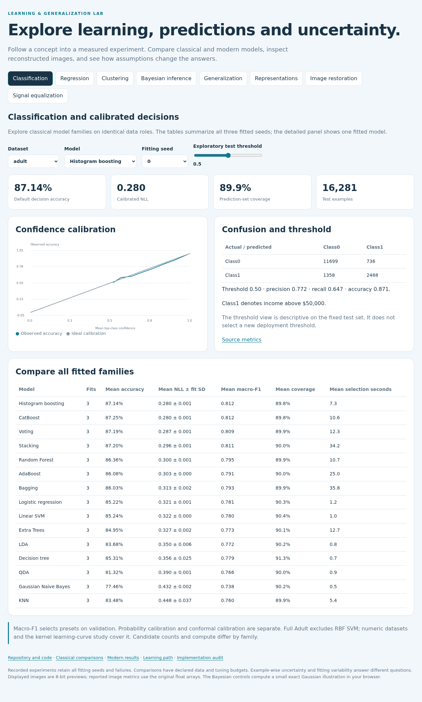
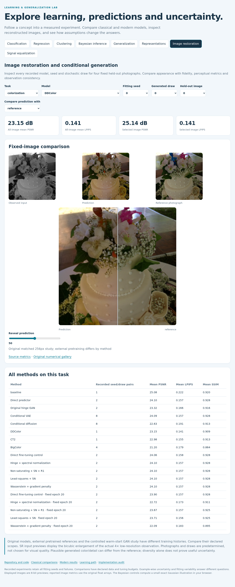

# Explore measured concepts in your browser

Open [explorer.html](explorer.html) after downloading or cloning the repository.
Double-clicking the file works: it reads local images and embedded numerical evidence,
with no running Python service, remote API, CDN or model download. Its controls explore
saved measurements; the Bayesian section also computes a small exact illustration.



| Section | Useful interaction | Evidence or calculation |
|---|---|---|
| Classification | Dataset, model, seed and descriptive decision threshold | 141 selected models; probability calibration, prediction sets, reliability and confusion |
| Regression | Random/geographic test, model and seed | 102 selected models; prediction/interval plots and complete-test coverage |
| Clustering | Dataset, method, seed and reference-label coloring | 63 transductive fits; full-data ARI, noise coverage and display-only PCA |
| Bayesian inference | Observation count, coefficient prior and assumed noise | Exact Gaussian posterior with browser Cholesky solves, checked against Python |
| Generalization | Regularization and learning-curve profiles | Repeated exact population risk, kernel budgets and logistic margin dynamics |
| Representations | Representation profile and available fitting seed | Scratch/contrastive/ImageNet/ConvNeXt comparisons with declared information budgets |
| Image restoration | Task, method, seed, draw, photograph and reveal slider | Original direct/GAN/CVAE/diffusion, released pretrained references, controlled GAN variants, fixed final endpoints and natural denoising |
| Signal equalization | Channel nonlinearity | Measured BER across SNR; three fitting seeds and known-channel information reference |

The classifier threshold controls describe the already measured test; they do not
select a deployment threshold. Regression plots show the first 200 predetermined
test examples, while summary metrics use the complete test. Clustering uses all
unlabeled data and makes no held-out prediction claim. Image galleries preserve
the same four attributed photographs and all recorded seeds/draws. PNG views use
8-bit quantization; metrics come from the original float measurements.



## Preview on GitHub

GitHub's repository view renders the screenshots and figures in the README. It does
not execute HTML as an application. After you publish the repository, you can enable
GitHub Pages manually: **Settings → Pages → Deploy from a branch → main → /(root)**.
The demo address then has the form `https://YOUR_USERNAME.github.io/YOUR_REPOSITORY/docs/explorer.html`.
Add that real address to the README after Pages finishes deploying. No hosting or
GitHub publication is performed by these preparation scripts.

For a local HTTP preview, run from the repository root:

```bash
python -m http.server 8000
```

Then open `http://localhost:8000/docs/explorer.html`. A server is optional for this
particular demo; it can be useful when checking the eventual hosted file layout.

## Rebuild and verify

```bash
python scripts/create_explorer.py
python scripts/validate_classical.py
python scripts/report_clustering.py
python scripts/validate_adversarial.py
python scripts/report_adversarial_endpoints.py
```

The generator requires all reference fits to be complete. `--allow-pending` is an
explicit development mode and fails final release validation. The optional browser
check requires Playwright and its Chromium browser:

```bash
python -m pip install playwright==1.63.0
python -m playwright install chromium
python scripts/check_explorer_browser.py
python scripts/validate_explorer.py
```

Set `PLAYWRIGHT_BROWSERS_PATH` to a personal external cache if desired. Browser checks
exercise all eight concepts, model presets, default/range controls, live Bayesian
arithmetic and a 390px mobile viewport. The independent demo validator compares each
published PNG with its numerical gallery and every embedded prediction row with its
measurement record. The manifest binds the HTML, templates, generator and evidence.
Read [browser checks](explorer_browser_validation.json) and [scientific checks](explorer_validation.json).

The source archive includes templates, HTML, images and numerical evidence. Wheels
carry the numerical package and default configs; obtain the repository/source archive
for full walkthroughs, measured reports and the browser gallery.

Preserve the root `.nojekyll` file when publishing this static explorer.
It bypasses Jekyll so the supplied HTML, JavaScript and evidence links are served
with their original paths. [GitHub documents this option](https://docs.github.com/en/pages/getting-started-with-github-pages/creating-a-github-pages-site).

See the [user interaction audit](demo_review.md) for the HTTP selector, slider,
asset and numerical verification commands and their precise scope.
