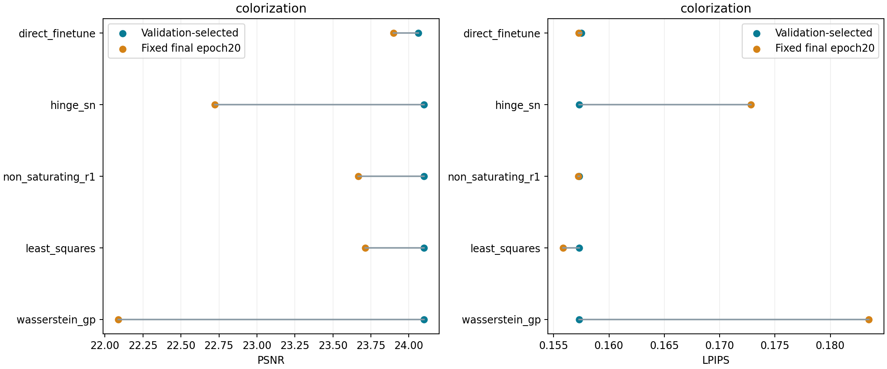
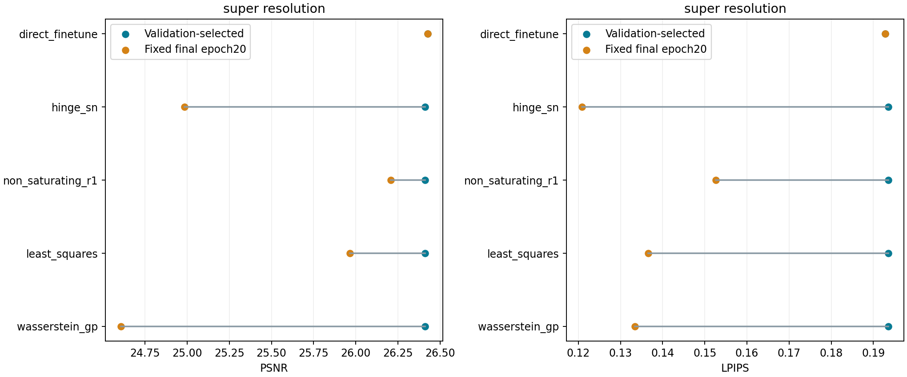

# What the final adversarial updates changed

Follow-up designed after validation retained many initial models: score every final epoch20 EMA without test-based selection. Metrics use float images; galleries are uint8 display arrays. These are diagnostic endpoints, separate from validation-selected deployment checkpoints.

All 20 fixed endpoints are evaluated. This follow-up was designed after observing validation-retained warm starts, before choosing or scoring any final endpoint by test performance. It adds no fitting and uses no best-of-test selection. The deployment study remains [validation-selected](adversarial_results.md). The endpoint comparison reveals changes and damage that selection may otherwise hide.

Tables average the two fitted seeds. The 400 photographs, observation process and metric protocol are unchanged. Endpoint gallery arrays are quantized for display; all metrics use full float images.

## Colorization

| Variant | Selected PSNR | Final PSNR | Selected LPIPS | Final LPIPS |
|---|---:|---:|---:|---:|
| direct_finetune | 24.063 | 23.899 | 0.1575 | 0.1573 |
| hinge_sn | 24.098 | 22.721 | 0.1573 | 0.1728 |
| non_saturating_r1 | 24.098 | 23.667 | 0.1573 | 0.1572 |
| least_squares | 24.098 | 23.713 | 0.1573 | 0.1559 |
| wasserstein_gp | 24.098 | 22.088 | 0.1573 | 0.1835 |



## Super Resolution

| Variant | Selected PSNR | Final PSNR | Selected LPIPS | Final LPIPS |
|---|---:|---:|---:|---:|
| direct_finetune | 26.426 | 26.426 | 0.1928 | 0.1928 |
| hinge_sn | 26.411 | 24.984 | 0.1936 | 0.1208 |
| non_saturating_r1 | 26.411 | 26.209 | 0.1936 | 0.1526 |
| least_squares | 26.411 | 25.965 | 0.1936 | 0.1366 |
| wasserstein_gp | 26.411 | 24.606 | 0.1936 | 0.1334 |



## Use the comparison

In [the explorer](explorer.html), each controlled family has a separate **fixed epoch20** entry. It preserves both seeds and the same four predetermined photographs. Vary the method while keeping photograph/seed fixed to see whether updates add plausible color/detail, distort the observation, or erase fidelity. Neither visual vividness nor a GAN label establishes accuracy or realism.

```bash
python scripts/evaluate_adversarial_endpoints.py --device cuda:0
python scripts/report_adversarial_endpoints.py
python scripts/restore_generative.py --checkpoint results/reference/adversarial_endpoints/colorization/wasserstein_gp/0/checkpoints/final_epoch.pt --input gray.png --output final_color.png
```

The sidecar identifies the fixed-final policy and epoch, while the checkpoint retains the base generator family. Read [all individual endpoints](adversarial_endpoints_individual.csv) and [validation](adversarial_endpoints_validation.json).
