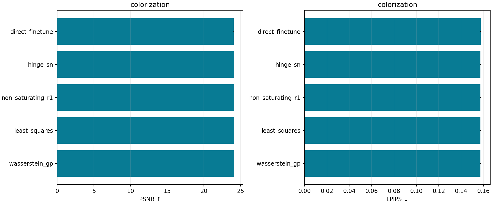
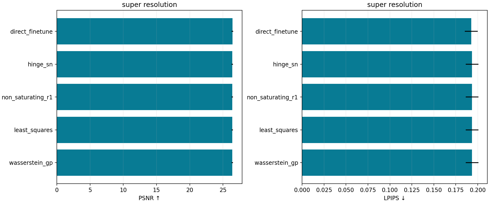

# Controlled adversarial restoration variants

Twenty full fits compare two tasks, five objectives and two seeds. All generators start from the same seed-specific validation-selected direct checkpoint. The direct fine-tuning control receives the same additional epochs, supervised losses, architecture, data order, learning rate and EMA schedule. Critic objective and regularization differ; their compute costs differ too.

Every fit completes 20 epochs and 10,000 generator updates using 16,000 training photographs. Selection uses 128 independent validation photographs and includes epoch 0. Scoring uses the same 400 held-out 256px photographs as the earlier restoration studies, with metric protocol 3. The initial model remains selected if all later checkpoints worsen validation. No test metric selects checkpoints, objectives or photographs.

## Objectives and scope

| Variant | Critic loss | Generator adversarial loss | Stabilization |
|---|---|---|---|
| direct_finetune | No critic | None | Supervised and frozen-feature control |
| hinge_sn | Half mean hinge loss | Negative mean fake score | Spectral normalization |
| non_saturating_r1 | Logistic softplus | Softplus of negative fake score | Spectral normalization and lazy real-image R1 |
| least_squares | Half squared real/fake targets | Half squared real-target loss | Spectral normalization |
| wasserstein_gp | Mean fake minus mean real | Negative mean fake score | RGB-interpolant gradient penalty, fixed condition |

Critics return mean patch scores per image. Gradient penalties differentiate only RGB, use float32 including second derivatives, and keep the observed condition fixed. WGAN-GP uses one critic update per generator; this controlled conditional adaptation does not reproduce the original paper's full training schedule. R1 uses gamma 10 every 16 updates with interval compensation. Generator objectives also include field L1 and 0.15 frozen ImageNet feature L1; adversarial weight is 0.02.

## Colorization

| Variant | PSNR, mean ± fit SD | SSIM | LPIPS, mean ± fit SD | Selected epochs |
|---|---:|---:|---:|---|
| direct_finetune | 24.063 ± 0.036 | 0.9283 | 0.1575 ± 0.0007 | [14, 0] |
| hinge_sn | 24.098 ± 0.013 | 0.9281 | 0.1573 ± 0.0004 | [0, 0] |
| non_saturating_r1 | 24.098 ± 0.013 | 0.9281 | 0.1573 ± 0.0004 | [0, 0] |
| least_squares | 24.098 ± 0.013 | 0.9281 | 0.1573 ± 0.0004 | [0, 0] |
| wasserstein_gp | 24.098 ± 0.013 | 0.9281 | 0.1573 ± 0.0004 | [0, 0] |



### Paired deltas against direct fine-tuning

| Variant | ΔPSNR, image CI | ΔLPIPS, image CI |
|---|---|---|
| hinge_sn | +0.0349 [-0.0158, +0.0826] | -0.0002 [-0.0010, +0.0007] |
| non_saturating_r1 | +0.0349 [-0.0158, +0.0826] | -0.0002 [-0.0010, +0.0007] |
| least_squares | +0.0349 [-0.0158, +0.0826] | -0.0002 [-0.0010, +0.0007] |
| wasserstein_gp | +0.0349 [-0.0158, +0.0826] | -0.0002 [-0.0010, +0.0007] |

## Super Resolution

| Variant | PSNR, mean ± fit SD | SSIM | LPIPS, mean ± fit SD | Selected epochs |
|---|---:|---:|---:|---|
| direct_finetune | 26.426 ± 0.121 | 0.7644 | 0.1928 ± 0.0074 | [20, 20] |
| hinge_sn | 26.411 ± 0.112 | 0.7637 | 0.1936 ± 0.0073 | [0, 0] |
| non_saturating_r1 | 26.411 ± 0.112 | 0.7637 | 0.1936 ± 0.0073 | [0, 0] |
| least_squares | 26.411 ± 0.112 | 0.7637 | 0.1936 ± 0.0073 | [0, 0] |
| wasserstein_gp | 26.411 ± 0.112 | 0.7637 | 0.1936 ± 0.0073 | [0, 0] |



### Paired deltas against direct fine-tuning

| Variant | ΔPSNR, image CI | ΔLPIPS, image CI |
|---|---|---|
| hinge_sn | -0.0151 [-0.0171, -0.0133] | +0.0008 [+0.0007, +0.0009] |
| non_saturating_r1 | -0.0151 [-0.0171, -0.0133] | +0.0008 [+0.0007, +0.0009] |
| least_squares | -0.0151 [-0.0171, -0.0133] | +0.0008 [+0.0007, +0.0009] |
| wasserstein_gp | -0.0151 [-0.0171, -0.0133] | +0.0008 [+0.0007, +0.0009] |

## Interpretation and limitations

Validation retains the warm start in 17 of 20 fits. Completion means the declared budgets finished, including unsuccessful updates. Small objective differences, weak chroma or identical selected images are retained. Two-seed SD describes fitting variation; paired image intervals condition on those two fits and average their per-image differences before resampling.

These conditional deterministic generators do not measure unconditional GAN diversity, mode coverage or state-of-the-art text-to-image generation. The earlier [local/external modern study](modern_results.md) supplies CVAE/diffusion draws and larger pretrained references. A variant's higher PSNR need not imply lower LPIPS or better exact chroma; no single metric establishes visual realism.

```bash
python scripts/run_adversarial_suite.py --devices cuda:0 cuda:1 cuda:2
python scripts/report_adversarial.py
python scripts/validate_adversarial.py
python scripts/restore_generative.py --checkpoint results/reference/adversarial_variants/colorization/wasserstein_gp/0/checkpoints/selected.pt --input gray.png --output color.png
```

Prepare the original L1 warm-start checkpoints first. The saved model is the selected EMA generator; critic weights are training state and are unnecessary for inference. Use [portable configs](../scripts/make_portable_configs.py) for your cache/results roots. All checkpoints remain private; numeric arrays permit independent release validation.

Primary references: [WGAN-GP](https://arxiv.org/abs/1704.00028), [spectral normalization](https://arxiv.org/abs/1802.05957), [R1 and GAN convergence](https://arxiv.org/abs/1801.04406), and [least-squares GAN](https://arxiv.org/abs/1611.04076). Explore all fixed photographs, seeds and objectives in [the local demo](explorer.html).
