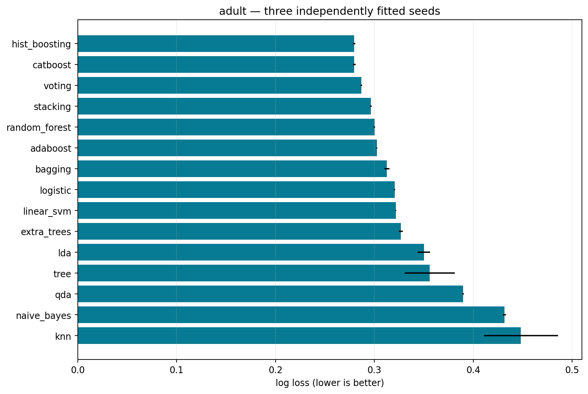
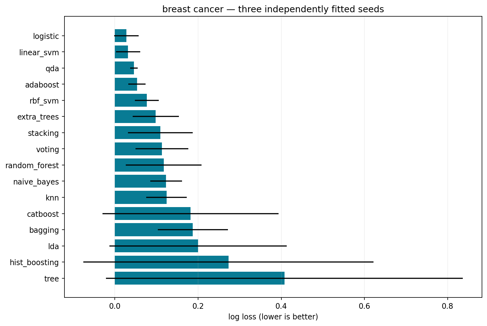
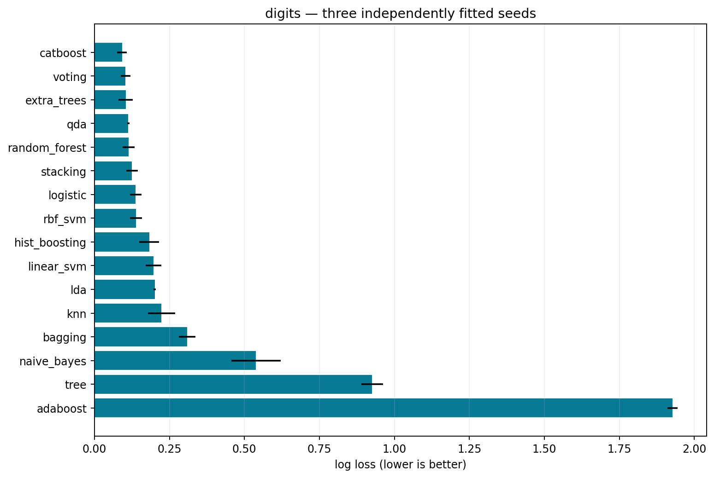
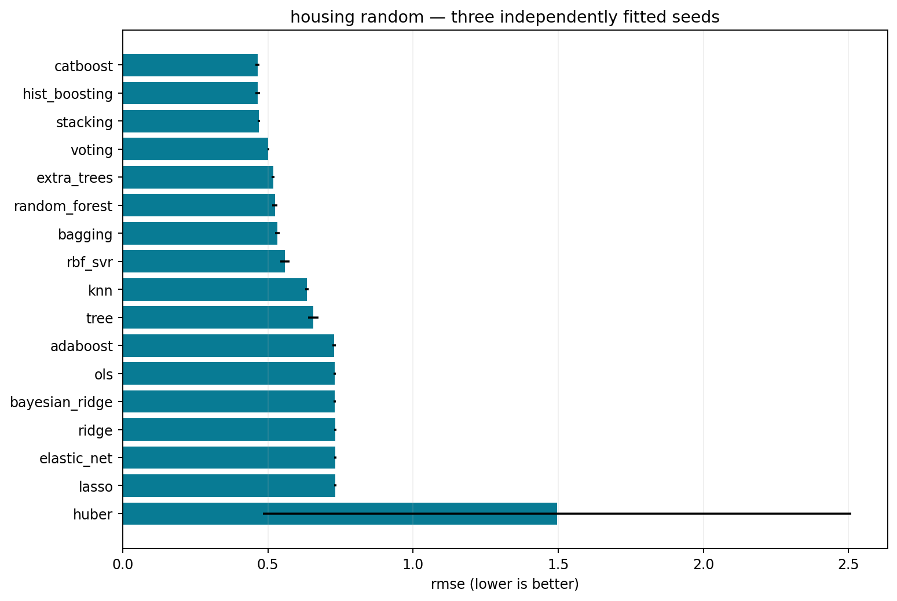
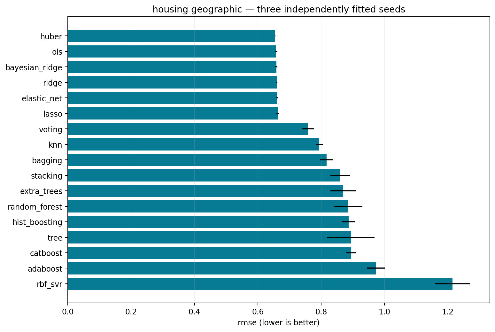

# Classical prediction comparisons

Fifteen full protocols contain 243 selected models across three fitting seeds. All methods share case-specific fitting, selection and calibration partitions; stacking refits preprocessing inside its inner folds. Candidate counts and compute differ by family and are recorded. Test data do not choose hyperparameters. Historical studies remain available separately.

## Classification

Validation macro-F1 selects presets. Probability temperature and prediction-set cutoffs use two separate calibration partitions. The Adult official test is preserved; numeric datasets have a common fixed stratified test. RBF SVM runs on the numeric datasets, alongside the existing label-budget kernel study, and is explicitly excluded from full Adult.

### Adult

| Model | Accuracy | NLL, mean ± fit SD | Macro-F1 | Set coverage |
|---|---:|---:|---:|---:|
| hist_boosting | 0.8714 | 0.2795 ± 0.0010 | 0.8119 | 0.8984 |
| catboost | 0.8725 | 0.2797 ± 0.0013 | 0.8117 | 0.8980 |
| voting | 0.8719 | 0.2869 ± 0.0007 | 0.8090 | 0.8987 |
| stacking | 0.8720 | 0.2964 ± 0.0007 | 0.8105 | 0.9001 |
| random_forest | 0.8636 | 0.3001 ± 0.0006 | 0.7947 | 0.8992 |
| adaboost | 0.8608 | 0.3027 ± 0.0004 | 0.7910 | 0.8998 |
| bagging | 0.8603 | 0.3127 ± 0.0025 | 0.7927 | 0.8994 |
| logistic | 0.8522 | 0.3205 ± 0.0005 | 0.7813 | 0.9032 |
| linear_svm | 0.8524 | 0.3218 ± 0.0005 | 0.7799 | 0.9043 |
| extra_trees | 0.8495 | 0.3268 ± 0.0021 | 0.7732 | 0.9009 |
| lda | 0.8368 | 0.3501 ± 0.0064 | 0.7723 | 0.9019 |
| tree | 0.8531 | 0.3560 ± 0.0253 | 0.7793 | 0.9130 |
| qda | 0.8132 | 0.3899 ± 0.0007 | 0.7661 | 0.8997 |
| naive_bayes | 0.7746 | 0.4316 ± 0.0015 | 0.7381 | 0.9025 |
| knn | 0.8348 | 0.4483 ± 0.0373 | 0.7605 | 0.8986 |



### Breast Cancer

| Model | Accuracy | NLL, mean ± fit SD | Macro-F1 | Set coverage |
|---|---:|---:|---:|---:|
| logistic | 0.9942 | 0.0277 ± 0.0293 | 0.9937 | 0.9561 |
| linear_svm | 0.9942 | 0.0317 ± 0.0291 | 0.9937 | 0.9561 |
| qda | 0.9825 | 0.0455 ± 0.0091 | 0.9812 | 0.9561 |
| adaboost | 0.9795 | 0.0531 ± 0.0208 | 0.9779 | 0.9532 |
| rbf_svm | 0.9737 | 0.0766 ± 0.0289 | 0.9716 | 0.9620 |
| extra_trees | 0.9678 | 0.0982 ± 0.0554 | 0.9654 | 0.9444 |
| stacking | 0.9825 | 0.1092 ± 0.0776 | 0.9810 | 0.9503 |
| voting | 0.9854 | 0.1129 ± 0.0633 | 0.9842 | 0.9474 |
| random_forest | 0.9678 | 0.1173 ± 0.0911 | 0.9654 | 0.9444 |
| naive_bayes | 0.9444 | 0.1233 ± 0.0382 | 0.9404 | 0.9532 |
| knn | 0.9766 | 0.1243 ± 0.0487 | 0.9746 | 0.9503 |
| catboost | 0.9766 | 0.1819 ± 0.2119 | 0.9747 | 0.9474 |
| bagging | 0.9678 | 0.1875 ± 0.0844 | 0.9654 | 0.9561 |
| lda | 0.9649 | 0.1997 ± 0.2132 | 0.9616 | 0.9444 |
| hist_boosting | 0.9620 | 0.2732 ± 0.3490 | 0.9588 | 0.9415 |
| tree | 0.9532 | 0.4077 ± 0.4293 | 0.9490 | 0.9532 |



### Digits

| Model | Accuracy | NLL, mean ± fit SD | Macro-F1 | Set coverage |
|---|---:|---:|---:|---:|
| catboost | 0.9694 | 0.0917 ± 0.0164 | 0.9694 | 0.9120 |
| voting | 0.9620 | 0.1037 ± 0.0161 | 0.9623 | 0.8972 |
| extra_trees | 0.9704 | 0.1040 ± 0.0233 | 0.9704 | 0.9083 |
| qda | 0.9796 | 0.1129 ± 0.0037 | 0.9796 | 0.9139 |
| random_forest | 0.9630 | 0.1134 ± 0.0201 | 0.9629 | 0.9157 |
| stacking | 0.9611 | 0.1248 ± 0.0192 | 0.9614 | 0.8870 |
| logistic | 0.9639 | 0.1373 ± 0.0190 | 0.9641 | 0.9019 |
| rbf_svm | 0.9852 | 0.1382 ± 0.0202 | 0.9852 | 0.9241 |
| hist_boosting | 0.9463 | 0.1823 ± 0.0332 | 0.9465 | 0.9083 |
| linear_svm | 0.9435 | 0.1963 ± 0.0262 | 0.9437 | 0.8815 |
| lda | 0.9454 | 0.2009 ± 0.0035 | 0.9457 | 0.8870 |
| knn | 0.9657 | 0.2236 ± 0.0459 | 0.9658 | 0.9185 |
| bagging | 0.8898 | 0.3094 ± 0.0273 | 0.8905 | 0.8981 |
| naive_bayes | 0.8657 | 0.5386 ± 0.0823 | 0.8698 | 0.8954 |
| tree | 0.7972 | 0.9260 ± 0.0360 | 0.8002 | 0.9454 |
| adaboost | 0.8889 | 1.9273 ± 0.0162 | 0.8910 | 0.8981 |



## Regression

California Housing uses the historical random and geographic partitions. Absolute-residual conformal intervals target 90% coverage under exchangeability; geographic coverage failure is retained. Housing target units are $100,000. These are declared practical presets with different tuning and compute budgets.

### Random

| Model | RMSE, mean ± fit SD | MAE | Coverage | Mean width |
|---|---:|---:|---:|---:|---:|
| catboost | 0.4641 ± 0.0071 | 0.3089 | 0.8999 | 1.3789 |
| hist_boosting | 0.4642 ± 0.0082 | 0.3065 | 0.8978 | 1.3850 |
| stacking | 0.4683 ± 0.0042 | 0.3114 | 0.8958 | 1.3842 |
| voting | 0.5006 ± 0.0031 | 0.3415 | 0.8968 | 1.4657 |
| extra_trees | 0.5182 ± 0.0050 | 0.3418 | 0.8983 | 1.5528 |
| random_forest | 0.5234 ± 0.0087 | 0.3435 | 0.8976 | 1.5836 |
| bagging | 0.5321 ± 0.0077 | 0.3508 | 0.8974 | 1.6117 |
| rbf_svr | 0.5577 ± 0.0156 | 0.3701 | 0.9014 | 1.7074 |
| knn | 0.6338 ± 0.0061 | 0.4360 | 0.9032 | 1.9362 |
| tree | 0.6552 ± 0.0179 | 0.4371 | 0.8979 | 2.0307 |
| adaboost | 0.7284 ± 0.0062 | 0.5990 | 0.8937 | 2.1860 |
| ols | 0.7305 ± 0.0042 | 0.5341 | 0.8983 | 2.1377 |
| bayesian_ridge | 0.7305 ± 0.0042 | 0.5341 | 0.8984 | 2.1375 |
| ridge | 0.7313 ± 0.0040 | 0.5344 | 0.8979 | 2.1350 |
| elastic_net | 0.7313 ± 0.0040 | 0.5349 | 0.8985 | 2.1337 |
| lasso | 0.7315 ± 0.0040 | 0.5354 | 0.8984 | 2.1343 |
| huber | 1.4962 ± 1.0131 | 0.5261 | 0.8978 | 2.1024 |



### Geographic

| Model | RMSE, mean ± fit SD | MAE | Coverage | Mean width |
|---|---:|---:|---:|---:|---:|
| huber | 0.6549 ± 0.0011 | 0.4598 | 0.9339 | 2.1690 |
| ols | 0.6581 ± 0.0033 | 0.4847 | 0.9374 | 2.1954 |
| bayesian_ridge | 0.6582 ± 0.0033 | 0.4849 | 0.9375 | 2.1948 |
| ridge | 0.6597 ± 0.0022 | 0.4878 | 0.9373 | 2.1920 |
| elastic_net | 0.6611 ± 0.0027 | 0.4910 | 0.9369 | 2.1956 |
| lasso | 0.6623 ± 0.0041 | 0.4936 | 0.9359 | 2.1858 |
| voting | 0.7581 ± 0.0193 | 0.6363 | 0.6305 | 1.4468 |
| knn | 0.7941 ± 0.0118 | 0.6514 | 0.8157 | 1.9774 |
| bagging | 0.8168 ± 0.0199 | 0.6923 | 0.5965 | 1.5327 |
| stacking | 0.8606 ± 0.0312 | 0.7190 | 0.5306 | 1.3928 |
| extra_trees | 0.8692 ± 0.0401 | 0.7396 | 0.5312 | 1.4927 |
| random_forest | 0.8852 ± 0.0445 | 0.7511 | 0.5302 | 1.5028 |
| hist_boosting | 0.8872 ± 0.0210 | 0.7419 | 0.4923 | 1.3655 |
| tree | 0.8935 ± 0.0750 | 0.7311 | 0.7238 | 1.9216 |
| catboost | 0.8946 ± 0.0166 | 0.7490 | 0.4896 | 1.3553 |
| adaboost | 0.9728 ± 0.0281 | 0.8619 | 0.6940 | 2.1186 |
| rbf_svr | 1.2146 ± 0.0545 | 0.8890 | 0.6028 | 1.7225 |



## Interpretation and reproduction

LDA/QDA Gaussian class assumptions, KNN geometry, linear penalties and ensemble diversity are explicit modeling choices. QDA rank warnings and convergence warnings are recorded per candidate; regularized covariances are used. CatBoost here receives the common transformed numeric features; the native categorical extension remains a separately labeled benchmark.

Three-seed SD is fitting variability; example-wise uncertainty conditional on a fitted model is a different quantity. The fixed numeric test is excluded from fitting, preprocessing, selection and calibration. Bundled Breast Cancer and Digits datasets are educational benchmarks; conclusions do not establish clinical deployment or large-image performance.

```bash
python scripts/run_classical.py --dataset adult --seed 0
python scripts/run_classical.py --dataset housing_random --seed 0
python scripts/report_classical.py
python scripts/validate_classical.py
```

Repeat seeds 0, 1, 2 and all five declared cases. `--quick` writes separate smoke outputs and uses fewer examples/trees. Saved selected sklearn models remain private; public predictions support independent metric verification. Full candidate parameters, timings, warnings and source digests are retained in each protocol. See [individual fits](classical_individual_fits.csv), [classification aggregates](classical_classification.csv) and [regression aggregates](classical_regression.csv).

Primary references: [scikit-learn LDA/QDA](https://scikit-learn.org/stable/modules/lda_qda.html), [neighbors](https://scikit-learn.org/stable/modules/neighbors.html), [ensembles](https://scikit-learn.org/stable/modules/ensemble.html), [linear models](https://scikit-learn.org/stable/modules/linear_model.html), and [support vector machines](https://scikit-learn.org/stable/modules/svm.html).
