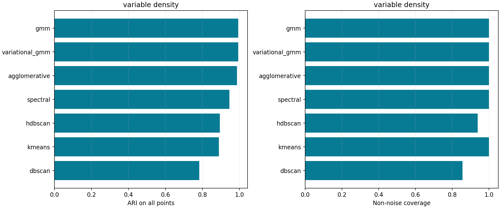
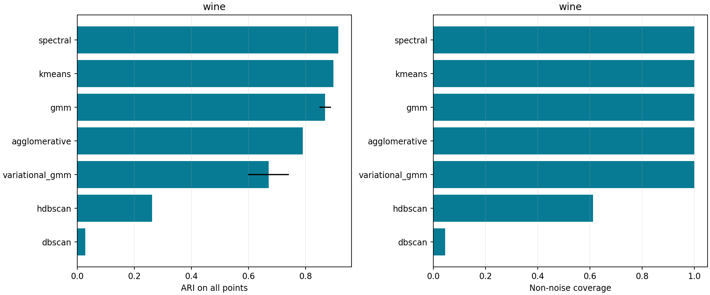
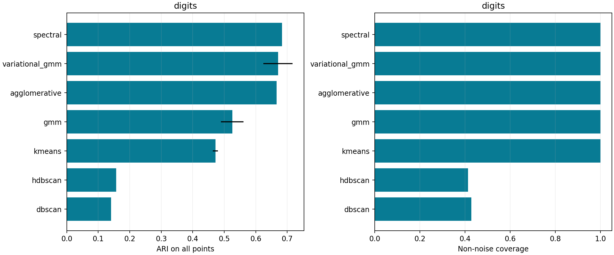

# Clustering geometry and noise coverage

Transductive unsupervised benchmarks. Class labels are diagnostic only. Known cluster counts are declared priors for count-constrained families; density families determine count and noise. Full-data PCA/scaling is explicit, with no held-out-generalization claim.

Seven families, three datasets and three seeds give 63 fitted results. Deterministic families repeat the same fit; their zero seed variance is not evidence of robustness to new datasets. Cluster-count priors differ from density methods, and presets are fixed before label evaluation.

Standardization uses all unlabeled examples. Digits uses 30 principal components; the two-dimensional projection is only a display. ARI includes noise points, and non-noise silhouette is explicitly conditional on accepted points. A visually clean tiny accepted subset can still have poor full-data recovery.

## Variable Density

| Method | ARI, mean ± fit SD | Coverage | Clusters | Conditional silhouette |
|---|---:|---:|---:|---:|
| gmm | 0.9934 ± 0.0000 | 1.000 | 3.0 | 0.683 |
| variational_gmm | 0.9934 ± 0.0000 | 1.000 | 3.0 | 0.683 |
| agglomerative | 0.9868 ± 0.0000 | 1.000 | 3.0 | 0.684 |
| spectral | 0.9447 ± 0.0000 | 1.000 | 3.0 | 0.693 |
| hdbscan | 0.8938 ± 0.0000 | 0.938 | 3.0 | 0.736 |
| kmeans | 0.8890 ± 0.0000 | 1.000 | 3.0 | 0.694 |
| dbscan | 0.7829 ± 0.0000 | 0.856 | 6.0 | 0.514 |

## Wine

| Method | ARI, mean ± fit SD | Coverage | Clusters | Conditional silhouette |
|---|---:|---:|---:|---:|
| spectral | 0.9149 ± 0.0000 | 1.000 | 3.0 | 0.286 |
| kmeans | 0.8975 ± 0.0000 | 1.000 | 3.0 | 0.285 |
| gmm | 0.8687 ± 0.0203 | 1.000 | 3.0 | 0.279 |
| agglomerative | 0.7899 ± 0.0000 | 1.000 | 3.0 | 0.277 |
| variational_gmm | 0.6702 ± 0.0711 | 1.000 | 6.0 | 0.196 |
| hdbscan | 0.2630 ± 0.0000 | 0.612 | 2.0 | 0.359 |
| dbscan | 0.0280 ± 0.0000 | 0.045 | 1.0 | nan |

## Digits

| Method | ARI, mean ± fit SD | Coverage | Clusters | Conditional silhouette |
|---|---:|---:|---:|---:|
| spectral | 0.6833 ± 0.0000 | 1.000 | 10.0 | 0.166 |
| variational_gmm | 0.6706 ± 0.0465 | 1.000 | 20.0 | 0.179 |
| agglomerative | 0.6659 ± 0.0000 | 1.000 | 10.0 | 0.152 |
| gmm | 0.5254 ± 0.0357 | 1.000 | 10.0 | 0.150 |
| kmeans | 0.4718 ± 0.0082 | 1.000 | 10.0 | 0.180 |
| hdbscan | 0.1568 ± 0.0000 | 0.413 | 7.0 | 0.333 |
| dbscan | 0.1408 ± 0.0000 | 0.427 | 16.0 | 0.277 |

## What the comparison shows

A mixture recovers the variable-density Gaussian construction well. Adaptive density does not guarantee recovery of semantic image classes: HDBSCAN rejects most Digits examples, and its full-data ARI is substantially weaker than the mixture reference. This is a retained limitation, not a hand-selected illustration of success.

Run `python scripts/run_clustering.py`, then `python scripts/report_clustering.py`. The second command verifies labels, representation fingerprints, source hashes and every metric without refitting. [Individual fits](clustering_individual_fits.csv) and [aggregates](clustering_aggregates.csv) retain all methods and seeds. Explore them in [the browser demo](explorer.html).

Primary references: [scikit-learn clustering](https://scikit-learn.org/stable/modules/clustering.html), [mixture models](https://scikit-learn.org/stable/modules/mixture.html), and [HDBSCAN API](https://scikit-learn.org/stable/modules/generated/sklearn.cluster.HDBSCAN.html).
