# Modern methods: measured comparisons

**Evidence status: complete.**

Generated by `scripts/build_upgrade_report.py` from saved run records. Full-precision per-image scores are public; galleries are display-only uint8 copies. Image intervals condition on the fitted checkpoints and fixed samples. Seed SD is descriptive across two training seeds, not a confidence interval. Local means fitted here: colorization's direct/GAN generators use ImageNet initialization, and its CVAE shares that fitted semantic mean. Feature-loss networks are also pretrained. External denotes a frozen released pipeline; neither label implies equal training exposure.

## Colorization

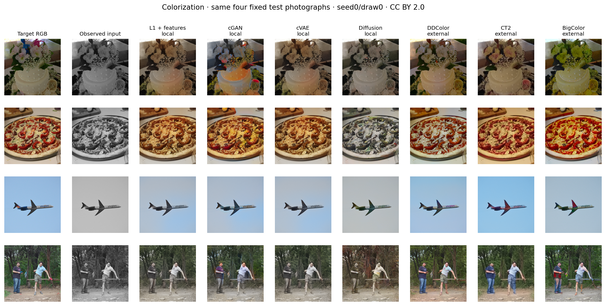

This compact comparison fixes seed0/draw0 for every pipeline. The baseline is the observed input. All fitted seeds and stochastic draws remain available in the individual gallery figures and walkthroughs. No photograph or draw was chosen using model quality.

| method | pipeline | fitted checkpoints | samples per seed | psnr | ssim | lpips | delta_e76 | data_consistency_l1 | RGB draw dispersion |
| --- | --- | --- | --- | --- | --- | --- | --- | --- | --- |
| baseline | local | 0 | 1 | 25.0783 | 0.9198 | 0.2216 | 16.1869 | 0.0000 | — |
| l1 | local | 2 | 1 | 24.0980 ± 0.0129 | 0.9281 ± 0.0005 | 0.1573 ± 0.0004 | 12.9122 ± 0.0178 | 0.0000 ± 0.0000 | — |
| gan | local | 2 | 1 | 23.3154 ± 0.0671 | 0.9162 ± 0.0007 | 0.1658 ± 0.0005 | 13.9519 ± 0.0211 | 0.0000 ± 0.0000 | — |
| cvae | local | 2 | 4 | 24.0904 ± 0.0004 | 0.9277 ± 0.0000 | 0.1573 ± 0.0001 | 12.9394 ± 0.0006 | 0.0000 ± 0.0000 | 0.0004 |
| diffusion | local | 2 | 4 | 22.6301 ± 0.1343 | 0.9133 ± 0.0004 | 0.1915 ± 0.0014 | 15.8718 ± 0.1918 | 0.0000 ± 0.0000 | 0.0288 |
| ddcolor | external | 1 | 1 | 23.1492 | 0.9090 | 0.1406 | 14.1258 | 0.0001 | — |
| ct2 | external | 1 | 1 | 22.9806 | 0.9130 | 0.1552 | 14.6424 | 0.0002 | — |
| bigcolor | external | 1 | 4 | 21.1971 | 0.8642 | 0.1790 | 17.5883 | 0.0004 | 0.0135 |

Paired differences preserve the same held-out images. Higher PSNR and lower LPIPS are preferable.

| method | metric | difference vs baseline | image CI lower | image CI upper |
| --- | --- | --- | --- | --- |
| l1 | psnr | -0.9803 | -2.6013 | 0.4359 |
| l1 | lpips | -0.0643 | -0.0709 | -0.0579 |
| gan | psnr | -1.7629 | -3.4025 | -0.3251 |
| gan | lpips | -0.0558 | -0.0630 | -0.0489 |
| cvae | psnr | -0.9879 | -2.6553 | 0.4356 |
| cvae | lpips | -0.0643 | -0.0707 | -0.0579 |
| diffusion | psnr | -2.4482 | -4.0298 | -1.0652 |
| diffusion | lpips | -0.0301 | -0.0342 | -0.0258 |
| ddcolor | psnr | -1.9291 | -3.6977 | -0.3865 |
| ddcolor | lpips | -0.0810 | -0.0905 | -0.0712 |
| ct2 | psnr | -2.0977 | -3.8832 | -0.5357 |
| ct2 | lpips | -0.0664 | -0.0756 | -0.0574 |
| bigcolor | psnr | -3.8812 | -5.6025 | -2.3861 |
| bigcolor | lpips | -0.0426 | -0.0519 | -0.0334 |

Paired differences against the trained direct predictor:

| method | metric | difference vs L1 + features | image CI lower | image CI upper |
| --- | --- | --- | --- | --- |
| gan | psnr | -0.7826 | -0.9352 | -0.6359 |
| gan | lpips | 0.0085 | 0.0060 | 0.0110 |
| cvae | psnr | -0.0076 | -0.0868 | 0.0676 |
| cvae | lpips | 0.0000 | -0.0010 | 0.0010 |
| diffusion | psnr | -1.4679 | -1.6884 | -1.2511 |
| diffusion | lpips | 0.0341 | 0.0302 | 0.0384 |
| ddcolor | psnr | -0.9488 | -1.2442 | -0.6538 |
| ddcolor | lpips | -0.0167 | -0.0225 | -0.0109 |
| ct2 | psnr | -1.1174 | -1.4320 | -0.8121 |
| ct2 | lpips | -0.0021 | -0.0073 | 0.0028 |
| bigcolor | psnr | -2.9009 | -3.1973 | -2.6101 |
| bigcolor | lpips | 0.0217 | 0.0159 | 0.0276 |

Distribution of per-image PSNR after averaging the fixed checkpoints and draws:

| method | images | PSNR median | PSNR Q25 | PSNR Q75 | PSNR above 60dB |
| --- | --- | --- | --- | --- | --- |
| baseline | 400 | 22.2111 | 19.1501 | 25.6139 | 11 |
| l1 | 400 | 24.3231 | 21.7333 | 26.6439 | 0 |
| gan | 400 | 23.3112 | 20.9353 | 25.8537 | 0 |
| cvae | 400 | 24.1904 | 21.8031 | 26.5850 | 0 |
| diffusion | 400 | 22.6728 | 20.1433 | 25.2437 | 0 |
| ddcolor | 400 | 23.2329 | 21.1152 | 25.4107 | 0 |
| ct2 | 400 | 23.0901 | 20.5334 | 25.4768 | 0 |
| bigcolor | 400 | 21.0731 | 18.7247 | 23.8907 | 0 |

The local GAN does not improve either mean PSNR or LPIPS over the direct predictor in this experiment. Validation selected epochs [21, 21]; all configured training epochs were completed. Training curves and fixed galleries retain this result rather than implying that adversarial learning automatically improves appearance.

The grayscale baseline preserves lightness exactly. Eleven nearly achromatic photographs exceed 60dB, including exact reconstructions at the numerical 120dB ceiling from MSE clipping at 1e-12. These values raise its mean PSNR; the median and quartiles reveal the typical-image behavior. All methods use the same scoring convention, and no images were removed. Lower LPIPS and DeltaE support different conclusions from mean PSNR.

Measured resource context:

| method | inference parameters (M) | epochs per fitted seed | local training images | selection images | training crop | summed epoch hours | seconds per 400 images including metrics |
| --- | --- | --- | --- | --- | --- | --- | --- |
| baseline | 0.0000 | 0 | 0 | 0 | — | — | 1.4912 |
| l1 | 12.4950 | 60 | 16000 | 128 | 128.0000 | 0.7224 | 2.5379 |
| gan | 12.4950 | 60 | 16000 | 128 | 128.0000 | 0.9388 | 1.9992 |
| cvae | 15.2996 | 20 | 16000 | 128 | 256.0000 | 1.5078 | 9.5168 |
| diffusion | 2.4895 | 60 | 16000 | 128 | 128.0000 | 0.8674 | 62.4798 |
| ddcolor | 227.8693 | 0 | 0 | 0 | — | — | 31.9233 |
| ct2 | 462.9773 | 0 | 0 | 0 | — | — | 27.5962 |
| bigcolor | 130.7528 | 0 | 0 | 0 | — | — | 15.8151 |

Parameter counts describe inference models and include frozen encoders; they exclude training-only feature networks and discriminators. Epoch hours sum training/validation loops over all fitted seeds, excluding initialization and checkpoint export. The colorization CVAE's latent epochs additionally depend on its shared 60-epoch direct predictor. Inference timings include metrics for one full 400-image draw; concurrent workloads and adapter preprocessing differ, so these are run context rather than controlled latency benchmarks.

### Does the CVAE use its latent variable?

| seed | selected epoch | selected-epoch posterior KL | final posterior KL | selected prior validation loss | test RGB draw dispersion |
| --- | --- | --- | --- | --- | --- |
| 0 | 18 | 0.0000 | 0.0000 | 0.0843 | 0.0004 |
| 1 | 20 | 0.0000 | 0.0000 | 0.0843 | 0.0004 |

KL values are training-batch averages from the posterior, summed over all latent dimensions. Prior validation uses the EMA checkpoint and observes no target in its encoder. Small KL together with negligible RGB draw dispersion is consistent with a nearly deterministic decoder; a low reconstruction loss alone does not establish useful conditional generation. These diagnostics do not estimate mutual information or prove posterior collapse.

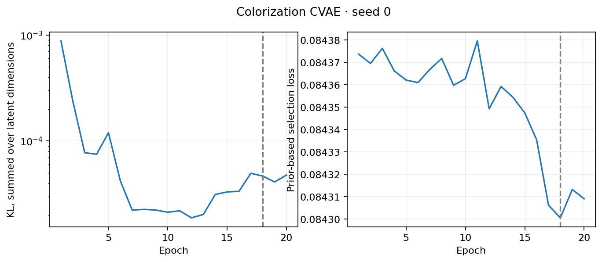

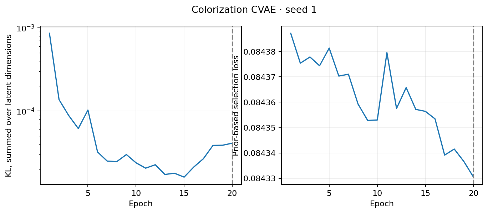

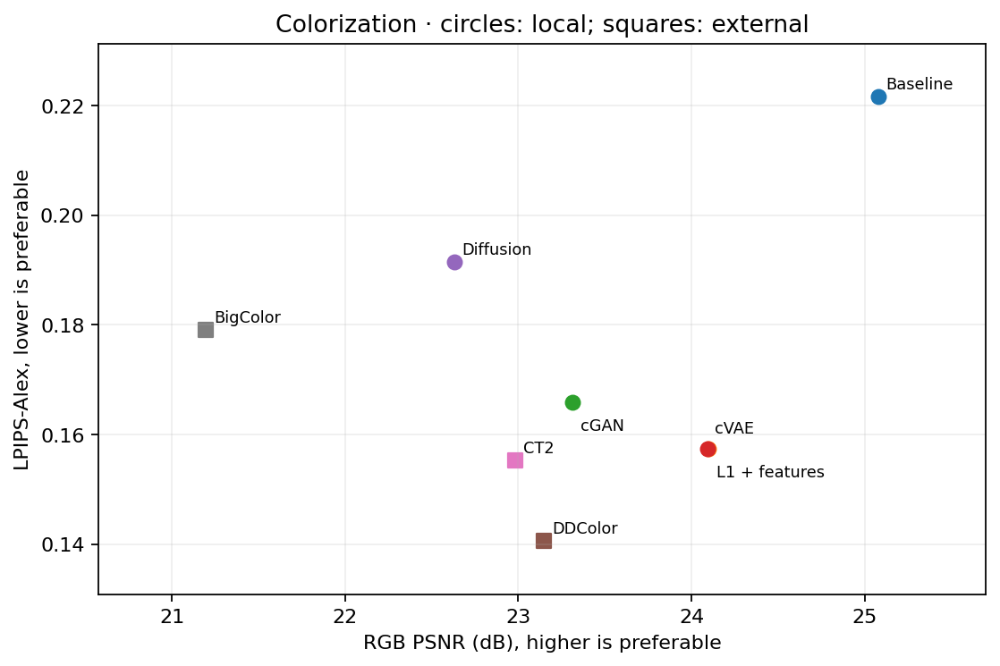

## Super Resolution

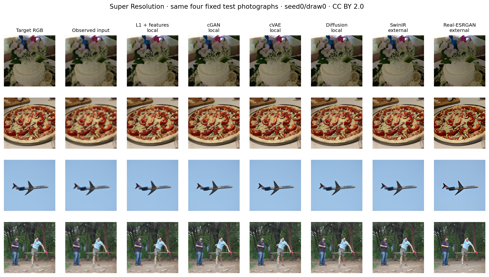

This compact comparison fixes seed0/draw0 for every pipeline. The baseline is the observed input. All fitted seeds and stochastic draws remain available in the individual gallery figures and walkthroughs. No photograph or draw was chosen using model quality.

| method | pipeline | fitted checkpoints | samples per seed | psnr | ssim | lpips | data_consistency_l1 | RGB draw dispersion |
| --- | --- | --- | --- | --- | --- | --- | --- | --- |
| baseline | local | 0 | 1 | 24.2567 | 0.6783 | 0.4618 | 0.0092 | — |
| l1 | local | 2 | 1 | 26.4109 ± 0.1123 | 0.7637 ± 0.0008 | 0.1936 ± 0.0073 | 0.0028 ± 0.0006 | — |
| gan | local | 2 | 1 | 25.4017 ± 0.0330 | 0.7287 ± 0.0011 | 0.2354 ± 0.0019 | 0.0034 ± 0.0001 | — |
| cvae | local | 2 | 4 | 26.3460 ± 0.0893 | 0.7632 ± 0.0009 | 0.1882 ± 0.0033 | 0.0031 ± 0.0005 | 0.0002 |
| diffusion | local | 2 | 4 | 23.8814 ± 0.0035 | 0.6580 ± 0.0016 | 0.1486 ± 0.0009 | 0.0015 ± 0.0001 | 0.0378 |
| swinir | external | 1 | 1 | 27.1322 | 0.7874 | 0.2233 | 0.0019 | — |
| realesrgan | external | 1 | 1 | 23.0266 | 0.6535 | 0.2064 | 0.0228 | — |

Paired differences preserve the same held-out images. Higher PSNR and lower LPIPS are preferable.

| method | metric | difference vs baseline | image CI lower | image CI upper |
| --- | --- | --- | --- | --- |
| l1 | psnr | 2.1542 | 2.0501 | 2.2618 |
| l1 | lpips | -0.2682 | -0.2734 | -0.2630 |
| gan | psnr | 1.1450 | 1.0766 | 1.2156 |
| gan | lpips | -0.2264 | -0.2306 | -0.2219 |
| cvae | psnr | 2.0893 | 1.9853 | 2.1929 |
| cvae | lpips | -0.2736 | -0.2789 | -0.2682 |
| diffusion | psnr | -0.3753 | -0.4630 | -0.2855 |
| diffusion | lpips | -0.3132 | -0.3205 | -0.3054 |
| swinir | psnr | 2.8755 | 2.7440 | 3.0115 |
| swinir | lpips | -0.2385 | -0.2449 | -0.2320 |
| realesrgan | psnr | -1.2301 | -1.3303 | -1.1289 |
| realesrgan | lpips | -0.2554 | -0.2625 | -0.2477 |

Paired differences against the trained direct predictor:

| method | metric | difference vs L1 + features | image CI lower | image CI upper |
| --- | --- | --- | --- | --- |
| gan | psnr | -1.0092 | -1.0631 | -0.9594 |
| gan | lpips | 0.0418 | 0.0395 | 0.0439 |
| cvae | psnr | -0.0649 | -0.0723 | -0.0581 |
| cvae | lpips | -0.0054 | -0.0057 | -0.0050 |
| diffusion | psnr | -2.5295 | -2.5773 | -2.4830 |
| diffusion | lpips | -0.0450 | -0.0508 | -0.0395 |
| swinir | psnr | 0.7213 | 0.6807 | 0.7643 |
| swinir | lpips | 0.0297 | 0.0269 | 0.0326 |
| realesrgan | psnr | -3.3843 | -3.5000 | -3.2702 |
| realesrgan | lpips | 0.0128 | 0.0078 | 0.0178 |

Distribution of per-image PSNR after averaging the fixed checkpoints and draws:

| method | images | PSNR median | PSNR Q25 | PSNR Q75 | PSNR above 60dB |
| --- | --- | --- | --- | --- | --- |
| baseline | 400 | 23.9354 | 22.0727 | 26.2069 | 0 |
| l1 | 400 | 26.2777 | 23.8032 | 28.6626 | 0 |
| gan | 400 | 25.0828 | 23.0724 | 27.4589 | 0 |
| cvae | 400 | 26.1846 | 23.7686 | 28.5722 | 0 |
| diffusion | 400 | 23.7716 | 21.3682 | 25.8642 | 0 |
| swinir | 400 | 26.8952 | 24.3412 | 29.4050 | 0 |
| realesrgan | 400 | 22.9041 | 20.9406 | 24.9455 | 0 |

The local GAN does not improve either mean PSNR or LPIPS over the direct predictor in this experiment. Validation selected epochs [1, 1]; all configured training epochs were completed. Training curves and fixed galleries retain this result rather than implying that adversarial learning automatically improves appearance.

Measured resource context:

| method | inference parameters (M) | epochs per fitted seed | local training images | selection images | training crop | summed epoch hours | seconds per 400 images including metrics |
| --- | --- | --- | --- | --- | --- | --- | --- |
| baseline | 0.0000 | 0 | 0 | 0 | — | — | 1.3408 |
| l1 | 2.4158 | 60 | 16000 | 128 | 128.0000 | 1.8263 | 2.4339 |
| gan | 2.4158 | 60 | 16000 | 128 | 128.0000 | 2.0688 | 2.7430 |
| cvae | 2.8084 | 60 | 16000 | 128 | 128.0000 | 1.0738 | 1.3885 |
| diffusion | 2.4912 | 60 | 16000 | 128 | 128.0000 | 0.8740 | 41.7704 |
| swinir | 11.9002 | 0 | 0 | 0 | — | — | 9.8671 |
| realesrgan | 16.6980 | 0 | 0 | 0 | — | — | 10.9994 |

Parameter counts describe inference models and include frozen encoders; they exclude training-only feature networks and discriminators. Epoch hours sum training/validation loops over all fitted seeds, excluding initialization and checkpoint export. The colorization CVAE's latent epochs additionally depend on its shared 60-epoch direct predictor. Inference timings include metrics for one full 400-image draw; concurrent workloads and adapter preprocessing differ, so these are run context rather than controlled latency benchmarks.

### Does the CVAE use its latent variable?

| seed | selected epoch | selected-epoch posterior KL | final posterior KL | selected prior validation loss | test RGB draw dispersion |
| --- | --- | --- | --- | --- | --- |
| 0 | 59 | 0.0003 | 0.0003 | 0.0796 | 0.0002 |
| 1 | 58 | 0.0003 | 0.0003 | 0.0786 | 0.0002 |

KL values are training-batch averages from the posterior, summed over all latent dimensions. Prior validation uses the EMA checkpoint and observes no target in its encoder. Small KL together with negligible RGB draw dispersion is consistent with a nearly deterministic decoder; a low reconstruction loss alone does not establish useful conditional generation. These diagnostics do not estimate mutual information or prove posterior collapse.

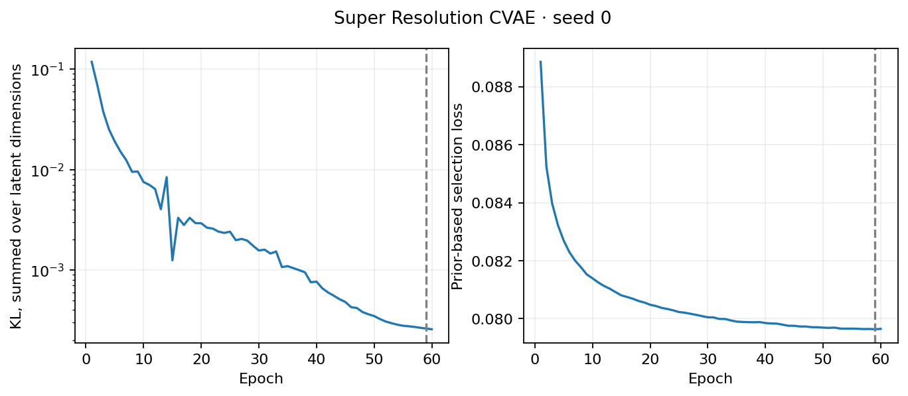

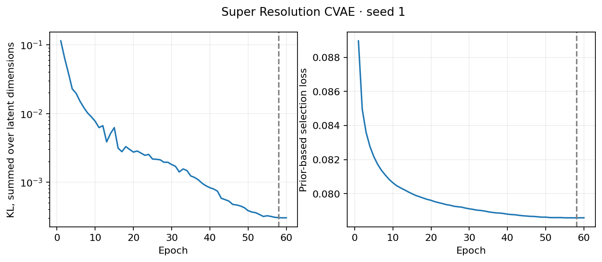

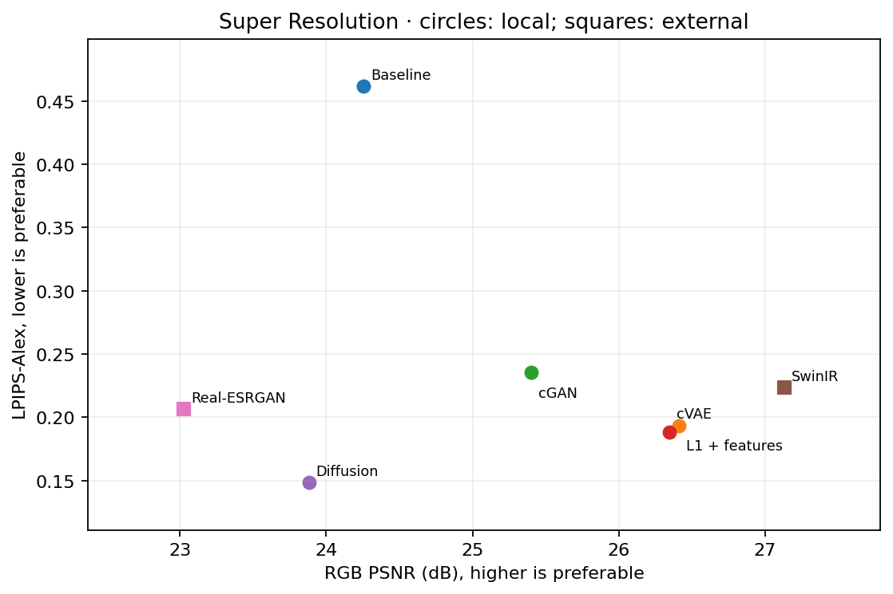

## Native categorical boosting

| seed | roc_auc | log_loss | ece | set_coverage | set_size | decision_cost | selected_depth |
| --- | --- | --- | --- | --- | --- | --- | --- |
| 0 | 0.9263 | 0.2790 | 0.0117 | 0.8988 | 1.0585 | 0.1975 | 8 |
| 1 | 0.9273 | 0.2768 | 0.0080 | 0.8969 | 1.0504 | 0.1978 | 6 |
| 2 | 0.9275 | 0.2765 | 0.0070 | 0.8973 | 1.0519 | 0.1930 | 6 |

Housing random versus geographic holdout:

| protocol | seed | rmse | mae | split coverage | split width | CQR coverage | CQR width | CQR empty rate |
| --- | --- | --- | --- | --- | --- | --- | --- | --- |
| random | 0 | 0.4358 | 0.2870 | 0.9002 | 1.3062 | 0.8832 | 1.4532 | 0.0000 |
| random | 1 | 0.4444 | 0.2864 | 0.8949 | 1.2776 | 0.8958 | 1.4533 | 0.0000 |
| random | 2 | 0.4511 | 0.2933 | 0.9038 | 1.3473 | 0.9079 | 1.5246 | 0.0000 |
| geographic | 0 | 0.9512 | 0.7963 | 0.4129 | 1.2503 | 0.3090 | 1.0611 | 0.0000 |
| geographic | 1 | 0.9795 | 0.8255 | 0.4160 | 1.3213 | 0.4502 | 1.4538 | 0.0000 |
| geographic | 2 | 0.9893 | 0.8187 | 0.4382 | 1.2941 | 0.3181 | 1.0957 | 0.0000 |

Boosting improves the random split but does not solve geographic shift. Conformal coverage assumptions fail under that shift; report the observed coverage.

Post-fit subgroup diagnostics, seed 0:

| feature | group | n | roc_auc | ece | set_coverage | tpr | fpr |
| --- | --- | --- | --- | --- | --- | --- | --- |
| sex | Female | 5421 | 0.9443 | 0.0095 | 0.9461 | 0.7610 | 0.0638 |
| sex | Male | 10860 | 0.9087 | 0.0142 | 0.8752 | 0.8710 | 0.2347 |
| race | Amer-Indian-Eskimo | 159 | 0.9613 | 0.0505 | 0.9434 | 0.8947 | 0.0929 |
| race | Asian-Pac-Islander | 480 | 0.9080 | 0.0602 | 0.8729 | 0.8496 | 0.1988 |
| race | Black | 1561 | 0.9472 | 0.0150 | 0.9411 | 0.7933 | 0.0709 |
| race | Other | 135 | 0.9720 | 0.0675 | 0.9037 | 0.7200 | 0.0273 |
| race | White | 13946 | 0.9229 | 0.0117 | 0.8945 | 0.8582 | 0.1827 |

Marginal conformal coverage does not guarantee group coverage. These descriptive test diagnostics do not establish fairness or causal effects and did not change the model. Small groups retain their counts.

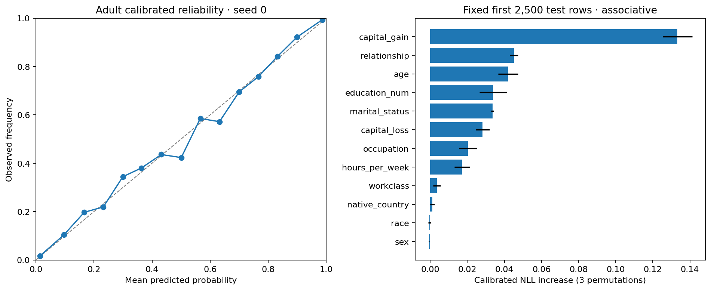

## Limited-label ConvNeXt transfer

Each seed uses 5,000 fitting labels plus 2,000 validation, 1,500 probability-calibration and 1,500 conformal-calibration labels. These 10,000 local labels have disjoint roles. Stratified benchmark sampling uses the available class annotations; this is a fitting-label budget, not an annotation-acquisition claim.

| accuracy | raw_nll | nll | temperature | set_coverage | set_size | model | seed | labels | best_epoch | gaussian_noise_accuracy |
| --- | --- | --- | --- | --- | --- | --- | --- | --- | --- | --- |
| 0.9614 | 0.2019 | 0.1459 | 0.6707 | 0.9024 | 0.9143 | convnext_tiny_finetuned | 0 | 5000 | 11 | 0.5503 |
| 0.9690 | 0.1895 | 0.1244 | 0.6319 | 0.9035 | 0.9120 | convnext_tiny_finetuned | 1 | 5000 | 26 | 0.5345 |
| 0.9692 | 0.2005 | 0.1260 | 0.6243 | 0.9122 | 0.9228 | convnext_tiny_finetuned | 2 | 5000 | 34 | 0.6959 |

The input is the same 32px CIFAR information resized to 128px. ImageNet pretraining is additional exposure. Comparison with scratch or self-supervised learning is a practical systems comparison; external-data overlap was not audited. Gaussian-noise accuracy reveals a substantial remaining robustness limitation.

Paired held-out NLL differences against earlier pipelines:

| seed | comparison | NLL difference | image CI lower | image CI upper |
| --- | --- | --- | --- | --- |
| 0 | ConvNeXt fine-tuning minus imagenet_resnet18 NLL | -0.3196 | -0.3376 | -0.3007 |
| 0 | ConvNeXt fine-tuning minus supervised_lowlabel NLL | -0.5873 | -0.6092 | -0.5624 |
| 0 | ConvNeXt fine-tuning minus contrastive_encoder NLL | -0.8074 | -0.8321 | -0.7839 |
| 1 | ConvNeXt fine-tuning minus imagenet_resnet18 NLL | -0.3459 | -0.3656 | -0.3272 |
| 1 | ConvNeXt fine-tuning minus supervised_lowlabel NLL | -0.6298 | -0.6550 | -0.6065 |
| 1 | ConvNeXt fine-tuning minus contrastive_encoder NLL | -0.8357 | -0.8607 | -0.8131 |
| 2 | ConvNeXt fine-tuning minus imagenet_resnet18 NLL | -0.3400 | -0.3585 | -0.3229 |
| 2 | ConvNeXt fine-tuning minus supervised_lowlabel NLL | -0.6166 | -0.6399 | -0.5947 |
| 2 | ConvNeXt fine-tuning minus contrastive_encoder NLL | -0.8196 | -0.8448 | -0.7952 |

Intervals condition on fitted checkpoints; architecture, pretraining and fine-tuning resources differ.

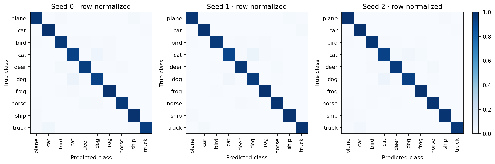

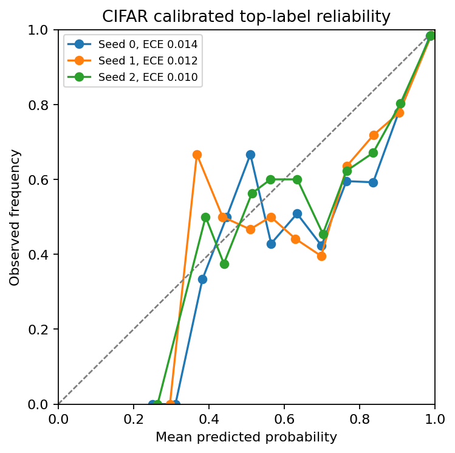

### Deployment prediction sets

| seed | profile | temperature | accuracy | nll | set_coverage | set_size | empty_set_rate | singleton_fraction | singleton_accuracy |
| --- | --- | --- | --- | --- | --- | --- | --- | --- | --- |
| 0 | cuda_bfloat16 | 0.6707 | 0.9614 | 0.1459 | 0.9024 | 0.9143 | 0.0857 | 0.9143 | 0.9870 |
| 0 | cpu_float32 | 0.6709 | 0.9615 | 0.1459 | 0.9038 | 0.9159 | 0.0841 | 0.9159 | 0.9868 |
| 1 | cuda_bfloat16 | 0.6319 | 0.9690 | 0.1244 | 0.9035 | 0.9120 | 0.0880 | 0.9120 | 0.9907 |
| 1 | cpu_float32 | 0.6309 | 0.9689 | 0.1243 | 0.9035 | 0.9121 | 0.0879 | 0.9121 | 0.9906 |
| 2 | cuda_bfloat16 | 0.6243 | 0.9692 | 0.1260 | 0.9122 | 0.9228 | 0.0772 | 0.9228 | 0.9885 |
| 2 | cpu_float32 | 0.6244 | 0.9694 | 0.1261 | 0.9104 | 0.9210 | 0.0790 | 0.9210 | 0.9885 |

Each profile evaluates all 10,000 official test images. CUDA preserves the original temperature and prediction sets; CPU temperature and cutoffs use only the reserved independent calibration partitions. Metadata binds the checkpoint and precision profile. Empty sets remain explicit. Singleton accuracy is descriptive and has no conditional coverage guarantee.

## Natural-image denoising and noise shift

| model | noise sigma | psnr | ssim | lpips |
| --- | --- | --- | --- | --- |
| noisy | 15 | 24.8873 | 0.5630 | 0.2231 |
| wavelet | 15 | 29.8898 | 0.8046 | 0.1342 |
| swinir_noise25 | 15 | 32.5951 | 0.8894 | 0.1159 |
| noisy | 25 | 20.6278 | 0.3925 | 0.4159 |
| wavelet | 25 | 27.1821 | 0.7202 | 0.2200 |
| swinir_noise25 | 25 | 32.2086 | 0.9008 | 0.0631 |
| noisy | 50 | 15.1256 | 0.2059 | 0.8123 |
| wavelet | 50 | 23.9830 | 0.5987 | 0.3664 |
| swinir_noise25 | 50 | 17.5864 | 0.2743 | 0.6447 |

SwinIR was trained externally at sigma 25. Sigma 15 and 50 test noise mismatch without adaptation. Wavelet BayesShrink uses the known test noise level. At sigma 50 the learned reference degrades strongly; this failure stays in the report.

## SR degradation stress tests

| method | degradation | psnr | ssim | lpips |
| --- | --- | --- | --- | --- |
| bicubic | bicubic | 24.2567 | 0.6783 | 0.4618 |
| swinir | bicubic | 27.1322 | 0.7874 | 0.2233 |
| realesrgan | bicubic | 23.0252 | 0.6535 | 0.2063 |
| bicubic | blur | 23.7997 | 0.6561 | 0.4944 |
| swinir | blur | 25.5992 | 0.7366 | 0.3611 |
| realesrgan | blur | 23.0491 | 0.6498 | 0.2071 |
| bicubic | noise_jpeg | 22.5947 | 0.5865 | 0.6381 |
| swinir | noise_jpeg | 22.4977 | 0.5782 | 0.5308 |
| realesrgan | noise_jpeg | 21.7854 | 0.5901 | 0.2582 |

The same fixed photographs receive bicubic downsampling, pre-downsampling Gaussian blur, or LR Gaussian noise followed by JPEG compression. Both external models remain frozen. These controlled stressors do not reproduce real camera acquisition or either paper's full degradation distribution.

## Interpretation and reproducibility

[Protocol and model equations](12_generative_restoration.md). [Attribution for every displayed photograph](photo_attributions.md). Local GANs and diffusion models have limited data and compute; a modern architecture alone does not guarantee a stronger output. All stochastic samples are included, with no closest-to-target selection. The CVAE uses its conditional prior at test time; only the colorization CVAE uses a shared frozen validation-selected semantic mean. External models have different training resources and possible unaudited overlap.

