# Measured course-project extensions

These are completed reference runs, separate from quick pipeline checks. See [protocols and derivations](10_course_projects.md) and [restoration design](11_image_restoration.md). Galleries use fixed held-out ordering; natural-image publication uses the first four test-order photographs with verified creator attribution. Photos retain their [source attribution](photo_attributions.md).

## Mixture geometry and missing data

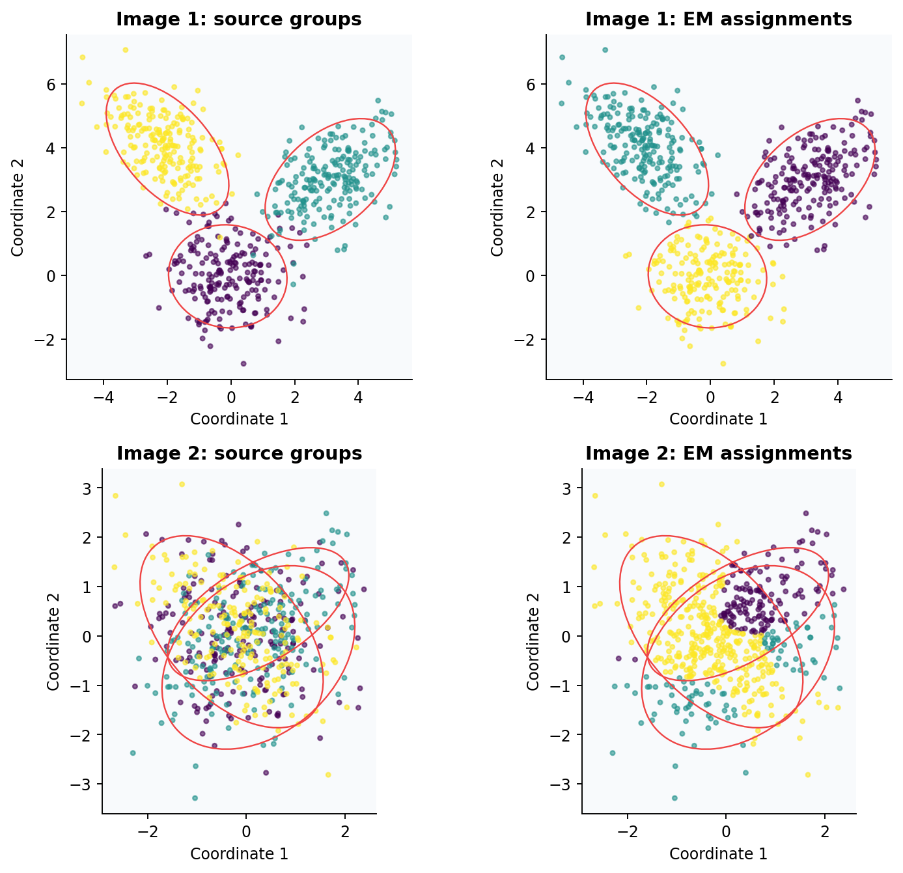

| Dataset | Model | Test ARI, mean ± seed SD | Test NLL, mean |
|---|---|---:|---:|
| Image 1 | custom_em_k3 | 0.9103 ± 0.0136 | 3.7880 |
| Image 1 | kmeans | 0.9515 ± 0.0635 | — |
| Image 1 | selected_gmm | 0.9103 ± 0.0136 | 3.7886 |
| Image 1 | sklearn_em_k3 | 0.9103 ± 0.0136 | 3.7886 |
| Image 1 | variational_gmm | 0.9103 ± 0.0136 | 3.8133 |
| Image 2 | custom_em_k3 | 0.0193 ± 0.0254 | 2.8265 |
| Image 2 | kmeans | 0.0149 ± 0.0208 | — |
| Image 2 | selected_gmm | 0.0149 ± 0.0285 | 2.8266 |
| Image 2 | sklearn_em_k3 | 0.0169 ± 0.0273 | 2.8267 |
| Image 2 | variational_gmm | 0.0010 ± 0.0009 | 2.8430 |

Image 2 centers nearly coincide: overlapping component labels cannot be recovered perfectly. Validation density chooses three full-covariance components in the first partition for both datasets. NLL describes density estimation; ARI describes agreement with supplied source groups. Labels do not enter fitting or selection.

| Missing-coordinate example | Conditional GMM RMSE | Mean-imputation RMSE |
|---|---:|---:|
| Image 1 | 1.3510 | 1.9896 |
| Image 2 | 0.9594 | 0.9719 |

The synthetic categorical mixture imputes **90.14%** of missing test entries correctly, versus **56.77%** for per-feature majority. Held-out latent ARI is 0.9928; this is a controlled identifiable model, not an external real-data benchmark.

## Bayesian patch reconstruction

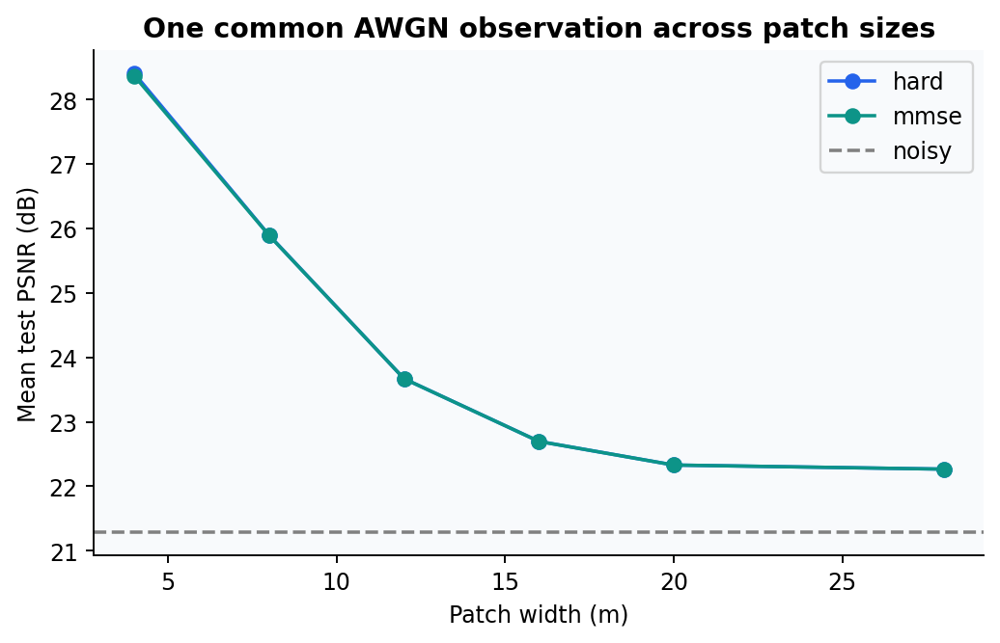

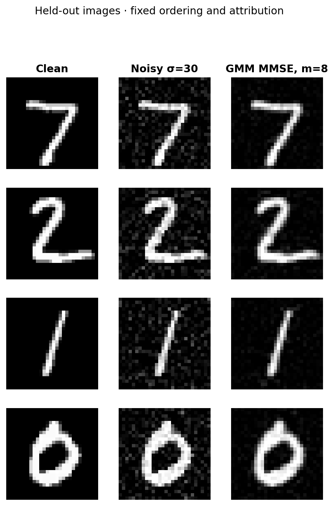

| Patch width | Validation-selected K | MMSE test PSNR | Hard-component test PSNR |
|---|---:|---:|---:|
| 4 | 12 | 28.369 | 28.406 |
| 8 | 12 | 25.892 | 25.896 |
| 12 | 12 | 23.670 | 23.670 |
| 16 | 12 | 22.697 | 22.697 |
| 20 | 12 | 22.330 | 22.330 |
| 28 | 4 | 22.267 | 22.267 |

The common noisy input scores 21.285 dB. Validation selects m=4, K=12; the test curve was not used to choose them. Prior convergence flags and PCA rank limits are in the metric record.

### Supplied archives: a separate, imperfect observation model

| Actual m | Raw PSNR | Hard PSNR | Nominal MMSE | Calibrated MMSE | Validation residual mean (0–255) |
|---|---:|---:|---:|---:|---:|
| 16 | 10.667 | 9.428 | 9.439 | 18.272 | 69.78 |
| 20 | 10.580 | 10.532 | 10.540 | 17.569 | 64.71 |
| 28 | 8.811 | 10.187 | 10.206 | 12.922 | 82.32 |
| 4 | 9.385 | 4.064 | 4.065 | 18.864 | 93.32 |
| 12 | 10.306 | 8.574 | 8.587 | 18.360 | 75.83 |

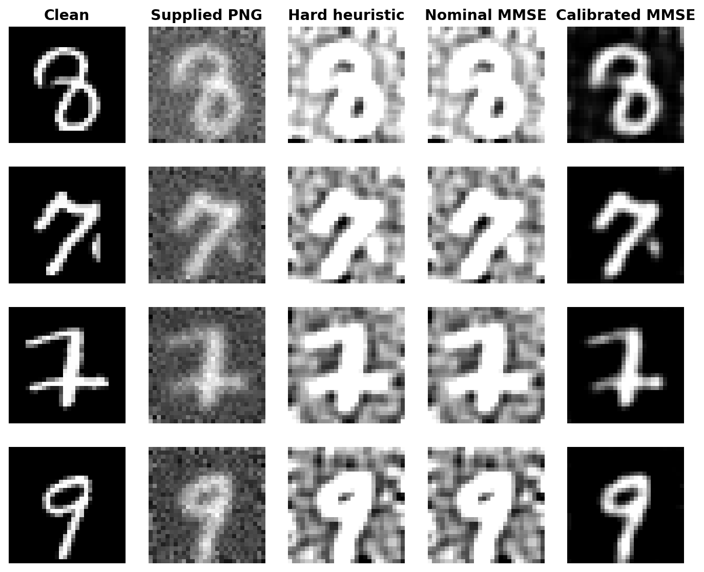

Clipped observations, mismatched filenames and nonzero empirical residual means limit the nominal independent Gaussian patch model. These results are not presented as controlled denoising scores or a common-data patch-size comparison.

## Neural denoising at σ=30

| Model | Test PSNR, mean ± seed SD | Test SSIM, mean |
|---|---:|---:|
| autoencoder | 26.150 ± 0.128 | 0.9601 |
| noisy | 21.272 ± 0.000 | 0.6067 |
| pca_projection | 23.399 ± 0.000 | 0.7285 |
| pca_wiener | 23.208 ± 0.000 | 0.7466 |
| residual_denoiser | 29.851 ± 0.020 | 0.9814 |

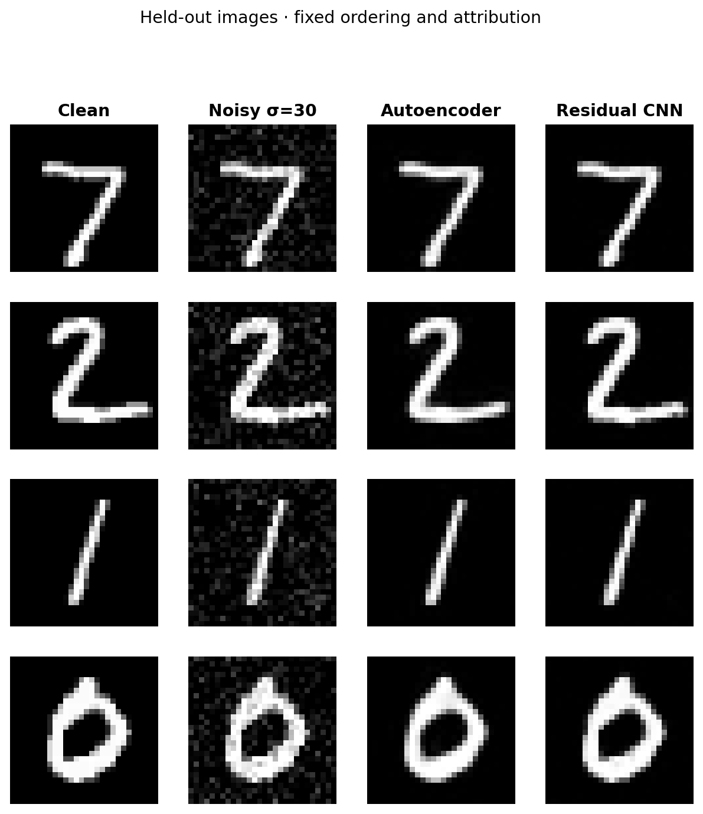

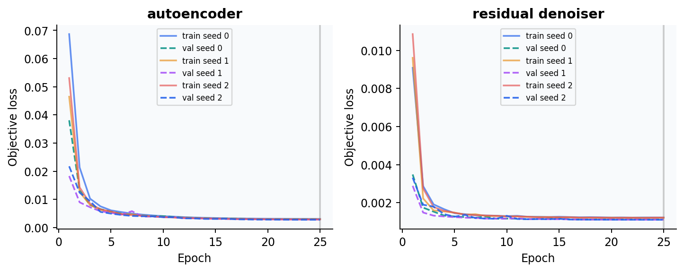

Per-image bootstrap intervals are in the metrics; the table's ± value is training-seed SD. Single deterministic baselines have zero seed SD, which does not imply zero test-image uncertainty.

## 4× natural-image super-resolution

| Model | Test PSNR, mean ± seed SD | Test SSIM, mean |
|---|---:|---:|
| autoencoder | 23.154 ± 0.000 | 0.6758 |
| bicubic | 22.139 ± 0.000 | 0.6161 |
| pixelshuffle_residual | 23.867 ± 0.002 | 0.7136 |

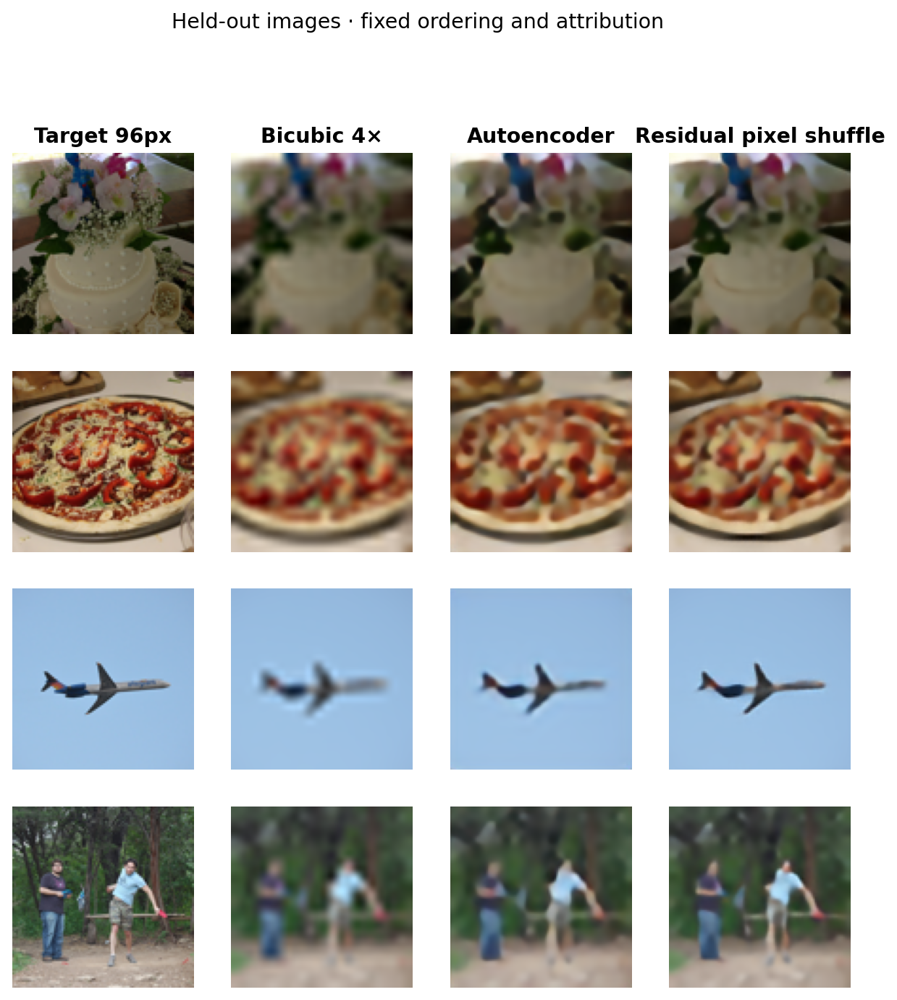

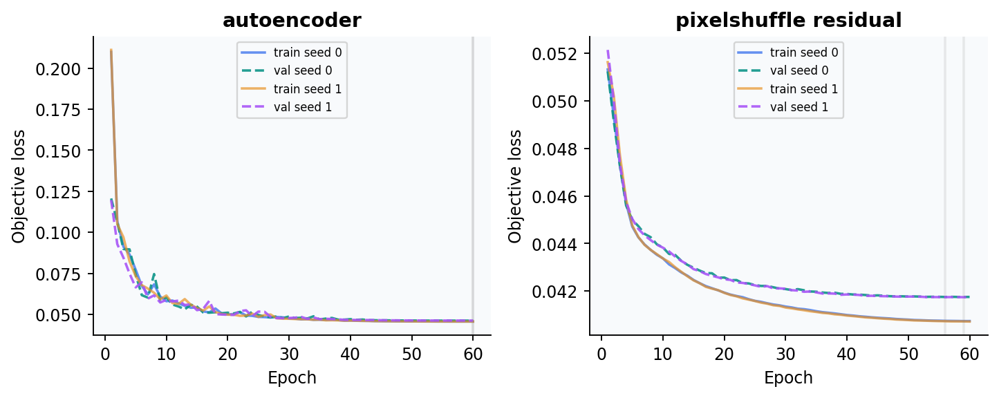

Per-image bootstrap intervals are in the metrics; the table's ± value is training-seed SD. Single deterministic baselines have zero seed SD, which does not imply zero test-image uncertainty.

## Color reconstruction and uncertainty

| Model | Test PSNR, mean ± seed SD | Test SSIM, mean | DeltaE76 | Mean chroma |
|---|---:|---:|---:|---:|
| autoencoder_l2 | 23.383 ± 0.005 | 0.9174 | 14.401 | 9.095 |
| ddcolor_modelscope_frozen | 22.974 ± 0.000 | 0.9089 | 14.985 | 16.082 |
| neutral_gray | 25.312 ± 0.000 | 0.9175 | 15.964 | 0.000 |
| transfer_balanced_bins | 22.918 ± 0.046 | 0.9142 | 15.498 | 14.262 |
| transfer_l2 | 23.671 ± 0.151 | 0.9209 | 14.000 | 10.757 |

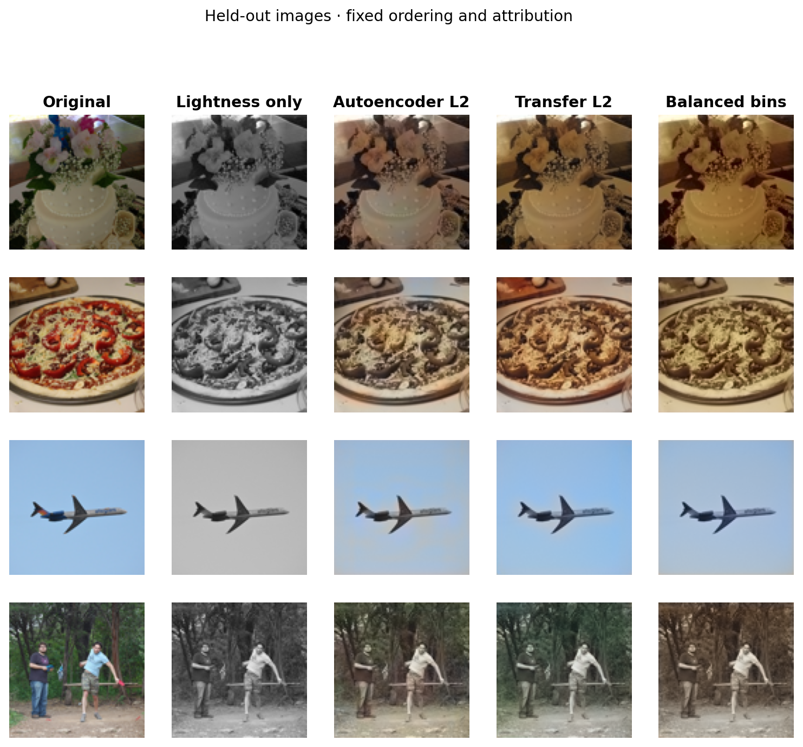

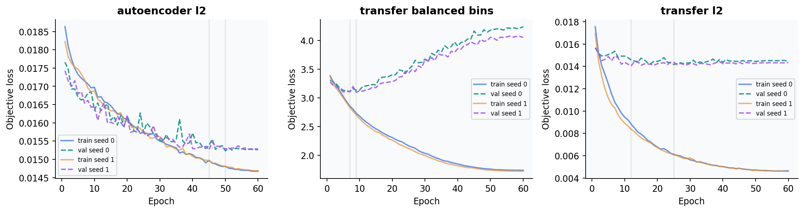

Per-image bootstrap intervals are in the metrics; the table's ± value is training-seed SD. Single deterministic baselines have zero seed SD, which does not imply zero test-image uncertainty.

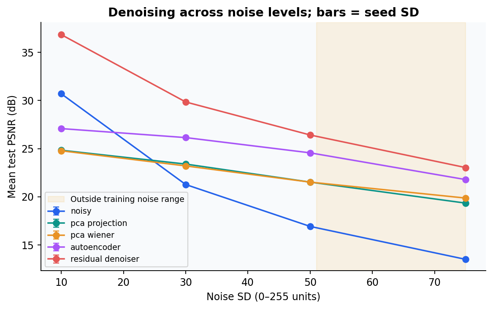

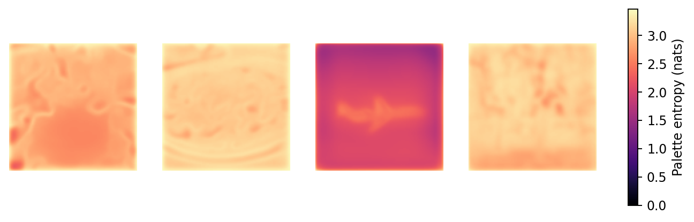

Colorization is underdetermined. A stronger chroma output or higher palette entropy is not evidence that original colors were recovered. Compare neutral gray, L2 regression, and balanced classification jointly using errors and the fixed galleries.

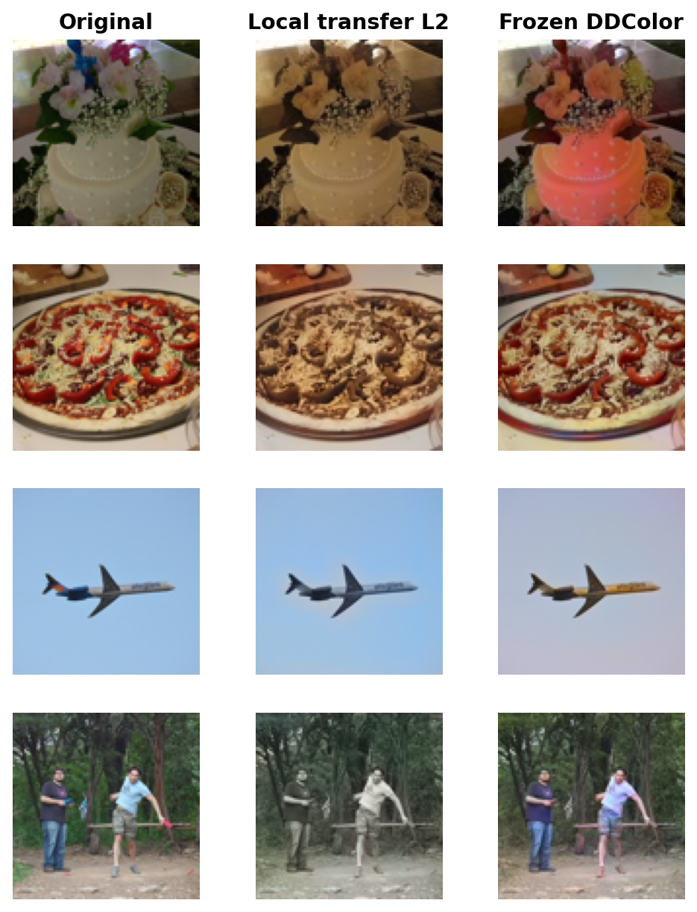

The frozen official DDColor-ModelScope model has 227,869,328 parameters and evaluates 33.94 images/s here. It uses externally trained ImageNet representations and color decoders; none of its parameters was fit in this laboratory. No COCO/pretraining overlap audit was possible. Its 512px internal input is an upsampled version of the same 96px lightness evidence, not additional high-resolution color input.

## Full evidence and reproduction

| Study | Complete run time (s) | Evidence |
|---|---:|---|
| course_mixtures | 92.5 | [metrics](../results/reference/course_mixtures/metrics.json), [run](../results/reference/course_mixtures/run.json) |
| inverse | 106.4 | [metrics](../results/reference/inverse/metrics.json), [run](../results/reference/inverse/run.json) |
| denoising | 135.6 | [metrics](../results/reference/denoising/metrics.json), [run](../results/reference/denoising/run.json) |
| super_resolution | 460.9 | [metrics](../results/reference/super_resolution/metrics.json), [run](../results/reference/super_resolution/run.json) |
| colorization | 1112.8 | [metrics](../results/reference/colorization/metrics.json), [run](../results/reference/colorization/run.json) |
| ddcolor | 21.3 | [metrics](../results/reference/ddcolor/metrics.json), [run](../results/reference/ddcolor/run.json) |

Full per-image PSNR arrays are losslessly compressed under `assets/source_data/<study>_per_image_scores.npz`; JSON row keys identify their arrays. This preserves paired comparisons without large repeated JSON lists. Gallery pixels and mixture figure inputs are also included, so every figure can be regenerated in a clean checkout. Model checkpoints, raw archives and unrelated original notebooks stay local.

Run `python scripts/build_report.py` to rebuild both reports and all figures. Read the [reproduction guide](07_reproduction.md) for caches, devices and clean-checkout checks. These budgets establish useful baselines and failure analysis; they do not establish state-of-the-art restoration performance.
