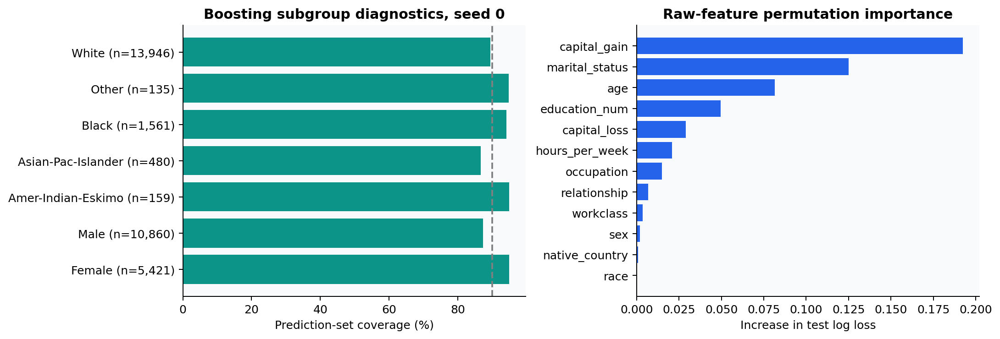
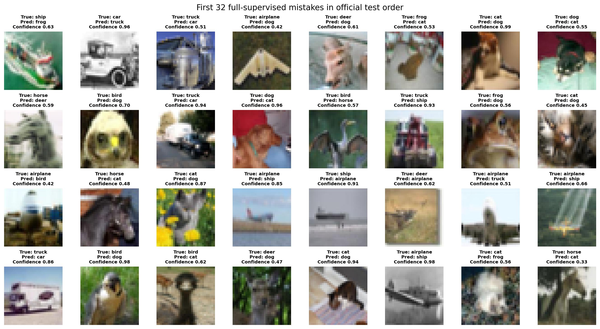

# Measured reference results

Generated by `python scripts/build_report.py` from completed reference records.
Every number below comes from a finished configured run. ± is the sample standard deviation across three seeds unless specified.

## Adult: probability quality and decisions

Official test: 16,281 examples. The natural, unweighted test distribution is preserved.

| Model | AUROC ↑ | AP ↑ | Calibrated NLL ↓ | Accuracy | Set coverage | Set size |
|---|---:|---:|---:|---:|---:|---:|
| Logistic | 0.9035 ± 0.0008 | 0.7586 ± 0.0020 | 0.3204 ± 0.0012 | 0.8524 ± 0.0007 | 0.9039 ± 0.0045 | 1.1219 ± 0.0135 |
| Boosting | 0.9257 ± 0.0006 | 0.8224 ± 0.0018 | 0.2796 ± 0.0011 | 0.8709 ± 0.0012 | 0.8987 ± 0.0016 | 1.0600 ± 0.0015 |
| Tabular ResNet | 0.9090 ± 0.0039 | 0.7767 ± 0.0087 | 0.3104 ± 0.0064 | 0.8555 ± 0.0032 | 0.8963 ± 0.0036 | 1.0895 ± 0.0095 |

Boosting leads the declared Adult comparison. The residual network improves on logistic probability loss in some partitions but does not displace the tree baseline. These results favor choosing models from validation evidence rather than assuming a neural architecture must win.

Paired test-example bootstrap for seed zero (1,000 repeats); differences are model NLL minus logistic NLL. These intervals are conditional on the fitted models:

- hist_boosting minus logistic NLL: -0.04142, 95% interval [-0.04561, -0.03705].
- tabular_resnet minus logistic NLL: -0.00326, 95% interval [-0.00710, 0.00127].

## Housing: prediction and interval reliability

Target units: $100,000. Requested interval coverage: 90%. Geographic rows hold out the easternmost longitude region; their calibration examples remain in the fitting geography.

| Split | Model | RMSE ↓ | MAE ↓ | Residual conformal coverage | Mean width |
|---|---|---:|---:|---:|---:|
| random | Ridge | 0.7313 ± 0.0040 | 0.5344 ± 0.0020 | 0.8979 ± 0.0018 | 2.1350 ± 0.0064 |
| random | Bayesian ridge | 0.7305 ± 0.0042 | 0.5341 ± 0.0022 | 0.8984 ± 0.0014 | 2.1375 ± 0.0080 |
| random | Boosting | 0.4630 ± 0.0088 | 0.3049 ± 0.0033 | 0.8983 ± 0.0043 | 1.3729 ± 0.0321 |
| random | Feature transformer | 0.5209 ± 0.0090 | 0.3448 ± 0.0076 | 0.9004 ± 0.0076 | 1.5786 ± 0.0451 |
| geographic | Ridge | 0.6597 ± 0.0022 | 0.4878 ± 0.0041 | 0.9373 ± 0.0083 | 2.1920 ± 0.0886 |
| geographic | Bayesian ridge | 0.6582 ± 0.0033 | 0.4849 ± 0.0061 | 0.9375 ± 0.0085 | 2.1948 ± 0.0921 |
| geographic | Boosting | 0.8738 ± 0.0166 | 0.7271 ± 0.0128 | 0.5130 ± 0.0182 | 1.3725 ± 0.0438 |
| geographic | Feature transformer | 0.8065 ± 0.0811 | 0.6434 ± 0.0765 | 0.7279 ± 0.0706 | 1.6282 ± 0.0310 |

CQR for boosting (separate quantile fits, with finite-sample calibration):

| Split | Coverage | Mean width | Empty interval rate |
|---|---:|---:|---:|
| random | 0.8955 ± 0.0043 | 1.3907 ± 0.0236 | 0.0000 ± 0.0000 |
| geographic | 0.5408 ± 0.0342 | 1.7053 ± 0.0306 | 0.0000 ± 0.0000 |

Boosting predicts best under the random protocol but extrapolates poorly across the chosen geography. Its interval coverage drops sharply under that shift, while linear models remain broader and perform better on this holdout. Calibration alone cannot recover an exchangeability assumption that the test protocol violates. Both fitted population and test population change between protocols, so RMSE differences are not solely an estimate of a single model's degradation.

## Image representations

Official test: 10,000 images. The frozen encoders use three 5,000-label subsets; only the scratch low-label network is retrained for each seed. Contrastive pretraining has one seed and the full-label supervised reference has one seed.

| Model / information budget | Accuracy ↑ | Calibrated NLL ↓ | Set coverage | Set size |
|---|---:|---:|---:|---:|
| Random features | 0.2627 ± 0.0016 | 2.0217 ± 0.0021 | 0.9035 ± 0.0028 | 6.5958 ± 0.0422 |
| Contrastive features | 0.6694 ± 0.0008 | 0.9530 ± 0.0072 | 0.8839 ± 0.0016 | 2.1271 ± 0.0289 |
| ImageNet transfer | 0.8371 ± 0.0006 | 0.4672 ± 0.0026 | 0.9000 ± 0.0006 | 1.1992 ± 0.0082 |
| Supervised 5k | 0.7600 ± 0.0044 | 0.7433 ± 0.0105 | 0.9023 ± 0.0109 | 1.6903 ± 0.1311 |
| Supervised 45k | 0.9279 (one run) | 0.2369 (one run) | 0.8949 (one run) | 0.9331 (one run) |

Contrastive features substantially improve on a frozen random encoder, but this 40-epoch pretraining budget trails scratch supervision at 5,000 labels. External ImageNet transfer supplies a strong reference with extra pretraining data and a different architecture. These information budgets are explicitly unequal.

Observed prediction-set coverage is empirical on the official test file. A nominal marginal guarantee averages over exchangeable calibration and test draws; it does not force exactly 90% coverage for this fixed calibration realization. In particular, contrastive prediction sets under-cover here, and the actual values are retained without test-driven cutoff adjustment.

Low-label scratch accuracy under Gaussian pixel noise, standard deviation 0.1 (no adaptation):

- Seed 0: clean 76.28%, corrupted 44.12%.
- Seed 1: clean 75.49%, corrupted 41.81%.
- Seed 2: clean 76.23%, corrupted 40.08%.

## Nonlinear communication channel

The table fixes SNR at 18 dB. Three seeds, 2,000 independent 64-symbol test blocks per seed and condition (512,000 bits). Other SNR values and block-bootstrap intervals are in the raw metrics.

| Test gamma | Receiver | BER ↓ | SER ↓ |
|---|---|---:|---:|
| 0.2 | Raw detector | 0.129209 ± 0.000199 | 0.465760 ± 0.001048 |
| 0.2 | Linear window | 0.004351 ± 0.000151 | 0.017305 ± 0.000619 |
| 0.2 | Known-channel inverse | 0.000163 ± 0.000005 | 0.000654 ± 0.000020 |
| 0.2 | Window MLP | 0.000871 ± 0.000031 | 0.003482 ± 0.000123 |
| 0.2 | Temporal CNN | 0.000510 ± 0.000021 | 0.002036 ± 0.000080 |
| 0.4 | Raw detector | 0.133639 ± 0.000338 | 0.480620 ± 0.001365 |
| 0.4 | Linear window | 0.011273 ± 0.000189 | 0.043029 ± 0.000584 |
| 0.4 | Known-channel inverse | 0.000069 ± 0.000007 | 0.000276 ± 0.000030 |
| 0.4 | Window MLP | 0.002273 ± 0.000245 | 0.009010 ± 0.000958 |
| 0.4 | Temporal CNN | 0.001663 ± 0.000165 | 0.006565 ± 0.000648 |

Neural receivers improve on the fitted linear-window receiver. The known-channel inverse is still stronger under this particular channel because it knows the test nonlinearity and FIR. Learned receiver error increases under gamma=0.4 mismatch. Gamma changes signal amplitude as well as distortion under the declared Es/N0 convention, so a known-channel receiver can benefit from the stronger amplitude.

## Density, generalization and kernels

- Mixture held-out NLL: custom EM 3.446242; reference EM 3.446219.
- Synthetic-label ARI: Gaussian mixture 0.9928; K-means 0.9154. BIC chooses 3 components.
- Wine bootstrap cluster stability: mean ARI 0.9348, descriptive resampling of 178 rows.
- Double descent: 100 observations, 14 nested feature budgets, three penalties, 30 repeats; exact Gaussian population MSE, with median/IQR plots.
- Logistic GD: final hard-margin direction cosine 0.99999855 after 30,000 steps.

| Kernel study | Training labels | Test accuracy |
|---|---:|---:|
| Logistic | 100 | 0.8956 ± 0.0270 |
| RBF SVM | 100 | 0.8933 ± 0.0342 |
| Nyström | 100 | 0.8881 ± 0.0281 |
| Logistic | 300 | 0.9319 ± 0.0068 |
| RBF SVM | 300 | 0.9452 ± 0.0250 |
| Nyström | 300 | 0.9378 ± 0.0139 |
| Logistic | 1000 | 0.9674 ± 0.0046 |
| RBF SVM | 1000 | 0.9756 ± 0.0044 |
| Nyström | 1000 | 0.9681 ± 0.0013 |

## Completed budgets and provenance

Wall time includes selection and evaluation, with studies running concurrently. It is not a hardware-normalized algorithm ranking.

| Study | Completion | Wall seconds | Raw evidence |
|---|---|---:|---|
| classification | complete | 19.8 | [metrics](../results/reference/classification/metrics.json), [run](../results/reference/classification/run.json) |
| regression | complete | 66.5 | [metrics](../results/reference/regression/metrics.json), [run](../results/reference/regression/run.json) |
| probabilistic | complete | 1.6 | [metrics](../results/reference/probabilistic/metrics.json), [run](../results/reference/probabilistic/run.json) |
| generalization | complete | 5.6 | [metrics](../results/reference/generalization/metrics.json), [run](../results/reference/generalization/run.json) |
| kernels | complete | 26.9 | [metrics](../results/reference/kernels/metrics.json), [run](../results/reference/kernels/run.json) |
| signals | complete | 30.2 | [metrics](../results/reference/signals/metrics.json), [run](../results/reference/signals/run.json) |
| vision | complete | 273.9 | [metrics](../results/reference/vision/metrics.json), [run](../results/reference/vision/run.json) |

Reference configs, versions, dates and exact partitions accompany the records. Original datasets and model checkpoints are excluded from Git. Compact figure inputs are included under `assets/source_data`, so the report can be regenerated without repeating training.

The benchmark is intentionally finite: three partitions are not a broad multi-dataset benchmark; the synthetic channel is not a physical fiber model; one contrastive pretraining seed does not estimate pretraining variance; and geographic stress testing is not a distribution-shift guarantee. See [model cards](09_model_cards.md) and [reproduction](07_reproduction.md).
